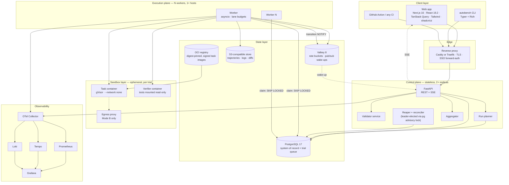
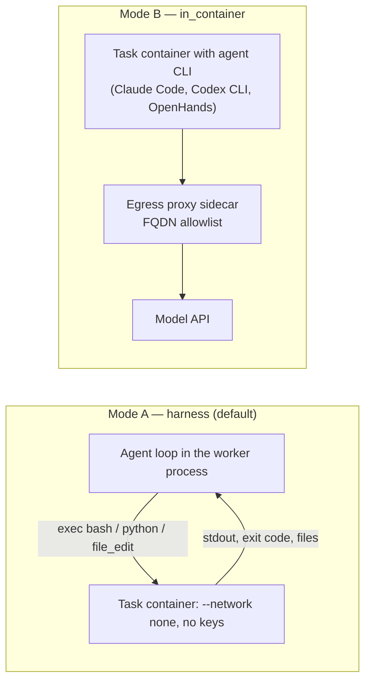
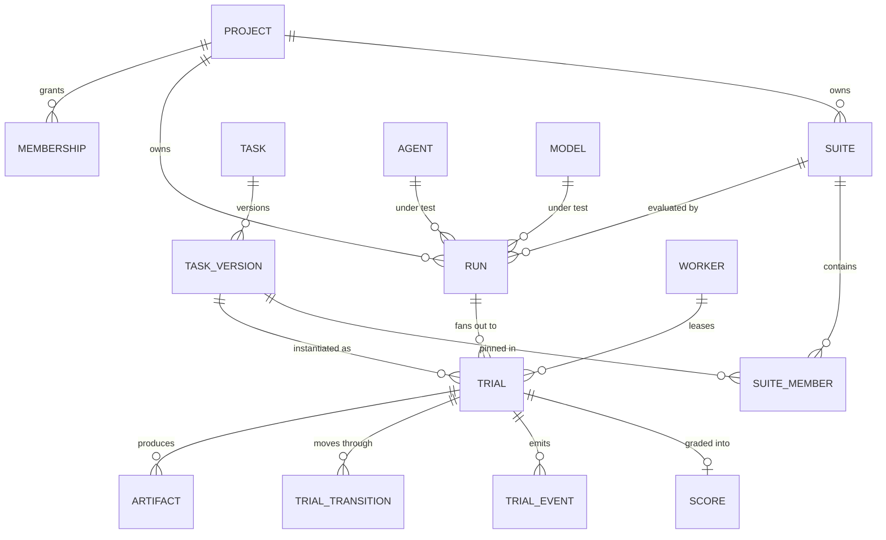
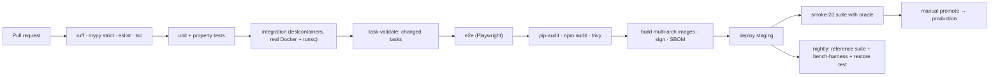
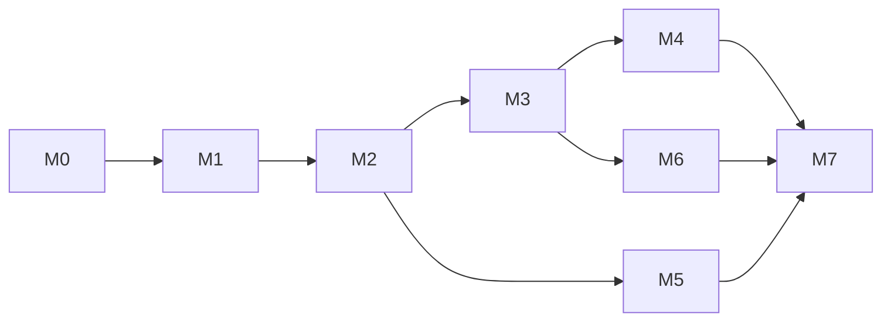

# Autobench — Product Requirements & Engineering Design

**A containerised, parallel evaluation platform for LLM agents — built to be deployed, operated and trusted in production.**

| Field | Value |
|---|---|
| Document | `AUTOBENCH_PRD.md` |
| Version | **2.0** |
| Supersedes | v1.0 (2026-09-20) |
| Status | Approved for build — production target |
| Date | 2026-10-02 |
| Owner | Kushagra |
| Target stack | Python 3.13 · FastAPI · Docker (+ gVisor) · PostgreSQL 17 · Valkey 8 · S3-compatible object store · Next.js 16 · React 19.2 · TypeScript |
| Build horizon | 10 weeks, 8 milestones, single engineer |
| Deployment targets | Single host (Docker Compose) → small fleet (Compose + remote workers) → Kubernetes (v1.3) |

---

## What changed from v1.0

v1.0 was a strong engineering design with three gaps for a production release: the use cases were implicit, the product (UI/UX) was specified as screens rather than as a design, and deployment stopped at "run Compose on one box". v2.0 closes those gaps and fixes six design defects found in review.

| # | Area | v1.0 | v2.0 | Why |
|---|---|---|---|---|
| D1 | **Queue** | Redis + arq queue, with lease state *also* in Postgres | **Postgres is the queue** (`SELECT … FOR UPDATE SKIP LOCKED`); Valkey keeps rate buckets and pub/sub only | Two sources of truth for one trial's state is a lost-or-double-scored trial waiting to happen. arq is also now maintenance-only [S24] |
| D2 | **Object store** | MinIO | **Any S3 API**; reference self-hosted backend SeaweedFS; managed S3 / GCS / R2 in cloud | MinIO's community edition went maintenance-only in Dec 2025, binaries stopped, and the repo was archived in Feb 2026 [S25][S26] |
| D3 | **Confidence intervals** | Wilson over all k·n trials | **Task-clustered bootstrap** for suite aggregates; Wilson only per task or when k = 1 | Attempts of the same task are correlated. Treating k·n trials as independent makes intervals too narrow — the statistics would overstate certainty, which the doc's own §9 forbids |
| D4 | **User namespaces** | `userns_mode: "host"` alongside daemon userns-remap | **Field removed**; remap applies by default; gVisor (`runsc`) is the default runtime for untrusted agents | `userns_mode: host` *opts the container out* of remapping — it silently disabled the protection it claimed to rely on |
| D5 | **Root filesystem** | `read_only: true` in §12 but `readonly_root = false` in `task.toml` | One rule: root FS read-only, `/app` a per-trial named volume, `/tmp` tmpfs | Contradictory defaults get resolved by whoever writes the code, not by the spec |
| D6 | **Live-update resume** | SSE `Last-Event-ID` over Redis pub/sub | Resume backed by the durable `trial_transition` log; pub/sub is only the wake-up signal | Pub/sub is fire-and-forget; you cannot resume from a message that was never stored |
| N1 | Use cases | Implicit in stories | §2: eight concrete use cases with workflows, plus where Autobench is and is not the right tool | — |
| N2 | Product design | Route list + one wireframe | §5: design principles, information architecture, screen specs, visual language, accessibility (WCAG 2.2 AA) | — |
| N3 | Production | "Run Compose on one box" | §15–§18: topologies, config reference, TLS, HA, backup/DR, upgrades, SLOs, runbooks, release engineering, multi-project RBAC + SSO | — |
| N4 | Framing | Résumé line in §19.1 | Replaced by a general **performance-claims policy** (§22.2) | A production document should not be organised around a CV bullet; the measurement discipline stays |
| N5 | Citations | Broken inline `(cite index=…)` fragments | Numbered `[S#]` references to the Sources table | Fragments rendered as noise in every viewer |

---

## The thesis

Agent evaluation is not model evaluation. A model eval is `prompt → response → compare`. An agent eval is `instruction → container → N tool calls → mutated filesystem state → verify the state`. The second needs infrastructure: isolation per trial, a queue, bounded concurrency, artifact capture, and statistics that admit the whole thing is stochastic.

Autobench is that infrastructure. It takes a directory of declaratively-specified tasks, runs each one K times against M agent/model combinations inside throwaway containers, grades the **final container state** rather than the agent's prose, and returns pass@k and pass^k with honest confidence intervals, cost, latency, and a replayable trajectory for every trial.

**The design commitment everything else follows from:** *a trial is a pure function of (task version, agent version, model version, seed), and it leaves nothing behind.*

**The operational commitment added in v2.0:** *when the harness is wrong, it says so before anyone reads the score.* Infra error rate, oracle drift and grader disagreement are surfaced as first-class signals that can invalidate a run.

---

## 1. Problem statement

### 1.1 What goes wrong without this

Teams shipping agents hit five failure modes. All five are infrastructure problems disguised as model problems.

| # | Failure mode | Symptom | Root cause |
|---|---|---|---|
| 1 | **Flake mistaken for capability** | Same agent, same task, scores swing several points between runs | Shared state, warm caches, unpinned images, live network |
| 2 | **Grader bugs read as model weakness** | Score is 42%; after a grading fix it is 95% | Rigid string matching, ambiguous specs, tests that measure console output instead of the world |
| 3 | **Single-trial reporting** | A headline number with no error bar | No repetition, no variance estimate |
| 4 | **Serial throughput** | A 200-task suite takes 9 hours; nobody runs it on PRs | No concurrency model, no image warm-up, no rate-limit budget |
| 5 | **Undiagnosable failures** | "It failed", with no trajectory | No structured event log, no artifact capture |

The evidence for #1 and #2 is not marginal. Anthropic reports Opus 4.5 initially scoring 42% on CORE-Bench until review found rigid grading that penalised a correctly-rounded number, ambiguous specifications and unreproducible stochastic tasks; after fixes and a less constrained scaffold, the score was 95%. METR separately found tasks that told agents to *reach* a threshold while the grader required *exceeding* it [S1]. An audit of agentic evals found single-run pass rates moving by roughly 2–6 points depending on which run was observed, even at temperature 0 [S11].

Those are harness results, not model results. Autobench's job is to make the harness the part you trust.

### 1.2 Prior art and where Autobench sits

| System | What it does well | Gap Autobench fills |
|---|---|---|
| **Inspect AI** (UK AISI) | Dataset → Task → Solver → Scorer primitives, multi-provider model layer, Docker/K8s sandboxes, log viewer [S5] | A library, not a service. No shared scheduler, warehouse or multi-user control plane |
| **Harbor / Terminal-Bench** | Task = instruction + Dockerfile + tests + oracle + time limit; tests check final container state; parallel execution across cloud sandbox providers [S2][S4] | CLI-first. No web UI, run history warehouse, or regression gating |
| **METR Hawk** | YAML-configured tasks/agents/models, isolated K8s pods, managed credentials, Postgres warehouse, web UI [S6] | Closest analogue; Kubernetes-native and internal. Autobench is Docker-first and self-hostable from one box upward |
| **CI runners** | Free, familiar | Reused runners make task order and leftover state non-deterministic — precisely wrong for evals [S10] |

**Position:** Harbor's task-format discipline + Inspect's solver/scorer separation + Hawk's warehouse and UI, packaged as a self-hostable full-stack service that one engineer can operate on a single 16-core host and grow to a small fleet.

### 1.3 Compatibility decision

Autobench's task format is a **superset of the Harbor layout** (`instruction.md`, `environment/`, `tests/`, `solution/solve.sh`, `task.toml`) [S3]. Autobench reads that layout unmodified and adds optional keys. This buys an existing corpus — the Harbor Hub lists 300+ datasets including Terminal-Bench, SWE-bench, tau-bench and OSWorld [S22] — instead of starting from zero.

Import is a first-class command: `autobench import harbor://terminal-bench@2.0` pulls, validates (§11.1) and registers every task; tasks failing a gate land in a quarantine list instead of the catalogue.

---

## 2. Use cases

### 2.1 Who uses it

| Persona | Job to be done | Primary surface |
|---|---|---|
| **Benchmark engineer** | Author tasks that are fair, hermetic and hard; prove each one with an oracle | Authoring wizard, task detail, CLI `validate` |
| **Agent / model developer** | Know whether a change made the agent better, worse, or just different | Run view, compare view, trial inspector |
| **Research / eval lead** | Publish numbers that survive scrutiny; track capability over time | Leaderboard, exports, run provenance |
| **Platform / MLOps engineer** | Keep the harness fast, cheap and up; plug it into CI | Ops dashboards, CLI `gate`, settings |
| **Engineering manager / buyer** | Choose between vendors or scaffolds on evidence | Compare view, cost-per-solve, reliability gap |
| **CI system** | Pass or fail a change on a machine-readable verdict | `autobench gate`, GitHub Action |

### 2.2 Eight concrete use cases

Each use case names the trigger, the workflow, and the output that makes it worth doing.

**UC1 — Model release gating.** *Trigger:* a new model checkpoint or provider version. *Workflow:* run the `core` suite at k = 5 against the candidate and the incumbent; open the compare view. *Output:* a flip list (tasks that changed outcome), pass@1 and pass^5 deltas with intervals, cost-per-solve delta. A release is blocked when pass^5 regresses beyond threshold with non-overlapping intervals.

**UC2 — Agent scaffold A/B.** *Trigger:* a prompt, tool or loop change in the agent. *Workflow:* hold the model fixed (Mode A harness, §4.3), vary the agent version, run both at k = 5 with the same seed set. *Output:* the scaffold's effect isolated from model variance; steps-per-solve shows whether the change made the agent more efficient or just luckier.

**UC3 — Pull-request regression check.** *Trigger:* a PR to an agent repo. *Workflow:* GitHub Action calls `autobench gate --suite smoke-20 --baseline main --max-regression 0.03` at k = 1. *Output:* a PR comment with flipped tasks and a link to each failing trajectory; non-zero exit on regression. Fast (<15 min) because the smoke suite is small and images are warm.

**UC4 — Benchmark authoring and QA.** *Trigger:* a new task or a task fix. *Workflow:* upload in the wizard → 11 validation gates run live (§11.1) → calibrate difficulty against a model panel → publish. *Output:* a task that provably passes with its oracle, fails with a null agent, is hermetic and deterministic — before any model ever sees it. This is the use case that stops grader bugs reaching a leaderboard.

**UC5 — Vendor or model selection.** *Trigger:* procurement, or "which model should power this feature?". *Workflow:* build a domain suite from the team's own tasks; run every candidate model through the same agent. *Output:* a leaderboard with error bars, cost-per-solve and p95 latency side by side. The reliability gap (pass@k − pass^k) is usually the deciding number for production use.

**UC6 — Capability tracking over time.** *Trigger:* nightly schedule. *Workflow:* run a pinned reference suite against a pinned model; separately run the oracle. *Output:* two time series. If the oracle series moves, the *harness* drifted; if only the model series moves, the *model or provider* changed. Silent provider-side updates are caught here [S23].

**UC7 — Failure analysis.** *Trigger:* a red cell in a run matrix. *Workflow:* open the trial → trajectory, filesystem diff and verdict side by side → copy the replay command → reproduce locally in the exact image. *Output:* a fixed bug — in the agent, the model prompt, or the task itself.

**UC8 — Environment QA for training pipelines.** *Trigger:* a batch of RL environments or synthetic tasks. *Workflow:* run the validator plus a small model panel to confirm each environment is solvable, non-trivial and non-leaky. *Output:* a filtered, calibrated environment set. (Rollout *export* for training is out of scope until v2.2; validation is in scope now.)

### 2.3 Where Autobench is deployed

| Setting | Typical shape | Why Autobench fits |
|---|---|---|
| **Frontier / applied AI lab** | Fleet of worker hosts, nightly + on-demand runs, many suites | Warehouse, leaderboard, provenance, harness-drift detection |
| **Product company shipping an agent** | One or two hosts, CI gate on every PR, weekly vendor check | Regression gating, cost tracking, trajectory debugging |
| **Benchmark / data vendor** | Authoring-heavy; tasks delivered to clients | Validator gates, oracle/null calibration, Harbor-compatible export |
| **University or research group** | One workstation, occasional large sweeps | Self-hosted, free, statistics fit for papers |
| **Regulated enterprise** | Air-gapped or VPC-only | Runs offline with vendored images and an OpenAI-compatible local model endpoint; no outbound telemetry |

### 2.4 Where it is the wrong tool

Stating this avoids misuse and scope creep.

- **Pure prompt → text evals** (classification, QA, summarisation scored by string match). Use a lightweight eval library; containers are overhead with no benefit.
- **Online A/B testing with real users.** Autobench evaluates offline, against fixed tasks.
- **Training-time evaluation inside a training loop** at thousands of evals per minute. Autobench optimises for correctness and diagnosability, not microsecond latency.
- **GPU-heavy tasks** (training a model inside the sandbox). Not supported in v1.

---

## 3. Goals, non-goals and service levels

### 3.1 Product goals (v1.0)

| ID | Goal | Measurable acceptance |
|---|---|---|
| G1 | Run any Autobench/Harbor-format task in an isolated container | Oracle scores exactly 1.0 on every task in the reference suite |
| G2 | Parallel execution with bounded, tunable concurrency | ≥40% wall-clock reduction vs sequential on the 50-task reference suite at N = 8, measured by `bench-harness`, 3 repeats |
| G3 | Deterministic, tamper-proof grading | Tests injected post-hoc; agent cannot read or modify them; identical inputs → identical verdicts across 5 repeats |
| G4 | Statistically honest reporting | pass@1, pass@k, pass^k, each with a 95% interval computed by the method in §10.3 |
| G5 | Full-stack web application | Author, launch, watch and diagnose entirely in the browser |
| G6 | Cost and latency accounting | Per-trial tokens and USD; p50/p95 per suite; cost within 2% of provider invoices |
| G7 | Regression gating | `autobench gate` exits non-zero on a configured regression |
| G8 | Multi-provider | Anthropic, OpenAI, Google and any OpenAI-compatible endpoint (vLLM, Ollama, SGLang) behind one interface |
| G9 | **Production operability** | SLOs in §3.3 met for 14 consecutive days on staging before GA |
| G10 | **Multi-user safety** | Projects, role-based access, SSO, audit log (§14.4) |

### 3.2 Out of scope (v1.0)

- Kubernetes operator (v1.3). The `SandboxProvider` interface makes it a swap, not a rewrite.
- RL rollout export (v2.2). Environment *validation* is in scope (UC8).
- Human annotation UI.
- Billing and metering across organisations. One organisation per deployment; many projects inside it.
- GPU-attached sandboxes.

**Non-goals, stated so they do not creep in:** Autobench does not author tasks for you, does not implement an agent, and does not judge prose by default. LLM-as-judge is opt-in per task and never the sole scorer for a task marked `deterministic = true`.

### 3.3 Service level objectives

These are what "production-ready" means operationally. They are measured from day one in staging.

| SLO | Target | Measured by |
|---|---|---|
| API availability (non-SSE endpoints) | 99.5% monthly | Synthetic probe on `/readyz` + 5xx ratio |
| API latency | p95 < 300 ms for reads, < 800 ms for `POST /v1/runs` | `http_server_duration` histogram |
| Live-update freshness | p95 < 2 s from trial transition to browser | Transition timestamp vs SSE delivery timestamp |
| Harness integrity | `infra_*` errors < 2% of trials per run | `autobench_trials_total{error_class=~"infra_.*"}` |
| Trial durability | 0 lost trials, 0 double-scored trials | Nightly reconciliation job (§16.4) |
| Oracle stability | Reference-suite oracle = 1.000 every night | Nightly bench |
| Container hygiene | 0 orphaned containers after 10 min | Reaper metric |

A run that breaches the harness-integrity SLO is automatically labelled **"invalid — harness"** in the UI and excluded from leaderboards until re-run. That is the operational commitment from the thesis, made mechanical.

---

## 4. System architecture

### 4.1 Layer map



### 4.2 The planes and why they are separate

| Plane | Processes | Scales by | Failure blast radius |
|---|---|---|---|
| Edge | Caddy / Traefik | — | Total for browser users; CLI can bypass on the private network |
| Control | `autobench-api` (2–4 replicas) | CPU, trivially | New launches pause; in-flight trials continue unaffected |
| State | Postgres, Valkey, object store | Vertically; Postgres is the hot path | Postgres down = total pause (workers stop claiming, resume cleanly). Valkey down = rate limiting falls back to local per-worker buckets at 1/N quota; live view degrades to polling. Object store down = trials finish but artifacts queue on local disk (bounded) |
| Execution | `autobench-worker` (N processes, M hosts) | Docker host capacity and provider limits | Lost worker → its leases expire and trials re-queue |
| Sandbox | Ephemeral containers | Per-worker lanes | One trial |

Control and execution are split so that **launching a run never blocks on running a trial**. That is what makes the API fast, workers restartable, and the system crash-tolerant without durable-workflow machinery.

### 4.3 Why Postgres is the queue (D1)

v1.0 put trials in a Redis queue *and* tracked their lease in Postgres. That is two writes in two systems per state change; any crash between them produces a trial that is queued-but-leased or leased-but-lost.

v2.0 claims work directly from the `trial` table:

```sql
-- Worker claim: one round-trip, atomic, contention-free.
UPDATE trial
SET    status = 'leased',
       worker_id = $1,
       lease_expires_at = now() + make_interval(secs => $2),
       attempt_count = attempt_count + 1
WHERE  id IN (
    SELECT id FROM trial
    WHERE  status = 'queued'
      AND  run_id IN (SELECT id FROM run WHERE status = 'running')
    ORDER  BY priority DESC, planned_order ASC
    FOR UPDATE SKIP LOCKED
    LIMIT  $3
)
RETURNING *;
```

- Throughput is far beyond need: trials last minutes, so even a 1,000-worker fleet issues a few claims per second.
- Workers block on `LISTEN trial_queued` with a 5-second poll fallback, so idle workers cost nothing.
- Every state transition is one transaction that also inserts a `trial_transition` row — the durable log behind SSE resume (D6) and the audit trail.
- Migration path if a run ever needs >10k concurrent workers: move claims to a dedicated queue (NATS JetStream, or Temporal for durable workflows) behind the same `TrialSource` interface.

### 4.4 Execution topology: where does the agent live?



| | Mode A — `harness` | Mode B — `in_container` |
|---|---|---|
| Agent loop location | Worker process | Inside the task container |
| Container network | `none` | Private bridge to the egress proxy only |
| API keys in container | Never | Never — the proxy holds them; the container gets a per-trial token |
| What it measures | The **model's** tool-use reasoning, scaffold fixed | The **whole product**: agent CLI + model |
| Reproducibility | Higher | Lower — CLI version is another axis, pinned in the agent definition |
| Default | ✅ | Opt-in per agent |

Mode B exists because real evaluation targets include agent CLIs that own their own loop [S2]. It is also the mode where a hostile or confused agent has both code execution and a network path, so §14 applies with no exceptions.

---

## 5. Product design

The UI is not a dashboard bolted onto an engine. It is where people decide whether to trust a number, so it is designed around that decision.

### 5.1 Design principles

1. **Uncertainty is visible or the number is hidden.** No metric renders without its interval. Two values whose intervals overlap are never coloured as better/worse.
2. **Reliability before capability.** pass^k sits next to pass@k everywhere, with the gap labelled. Shipping decisions depend on the worst case.
3. **The harness reports on itself.** Infra failures, retries and oracle drift are shown with the same prominence as scores. A run with a broken harness looks broken.
4. **Every red cell is one click from its cause.** Matrix → trial → trajectory + diff + verdict + replay, without leaving the browser.
5. **Provenance is never more than a hover away.** Any number can show the exact task versions, image digests, agent version, model version, seed and harness version that produced it.
6. **Same answer in the browser, CLI and API.** The UI is a client of the public API; there is no UI-only capability.
7. **Calm by default.** Colour is reserved for state that needs attention. A healthy run is mostly neutral.

### 5.2 Information architecture

```
Project (workspace)
├── Home                    what needs attention: failing gates, invalid runs, spend vs budget
├── Runs                    history · filters · saved views
│   └── Run                 header · metrics · matrix · failures · cost · latency · workers · provenance
│       └── Trial           trajectory · filesystem diff · verdict · artifacts · replay
├── Compare                 run A vs run B · flip list · paired statistics
├── Leaderboard             per suite · best run per agent×model · error bars · export
├── Suites                  members (pinned versions) · history sparklines · health
├── Tasks                   catalogue · filters
│   ├── Task                instruction · environment · versions · calibration · difficulty curve
│   └── New task            upload → live validation → calibration → publish
├── Agents & models         registered agents, model endpoints, pricing versions
└── Settings                members & roles · API keys · providers & limits · budgets · workers · audit log
```

Global elements: project switcher, command palette (`⌘K` — jump to run/task/trial by id or name), and a persistent **harness status pill** (green/amber/red, linking to the ops view).

### 5.3 Key screens

**Home.** Three cards: *Needs attention* (failing CI gates, runs marked invalid, tasks failing nightly oracle), *Running now* (live mini-matrices), *Spend* (week-to-date vs budget). No vanity charts.

**Run view** — the centre of gravity.

```
┌─────────────────────────────────────────────────────────────────────────────┐
│ core-50 · claude-code@1.4.2 · opus-5 · k=5          ● Running   [⋯] [Cancel]│
│ 143/250 trials · 12m 04s · ~8m left · $18.22 of $60 budget · harness ● ok   │
├─────────────────────────────────────────────────────────────────────────────┤
│  pass@1          pass@5          pass^5          reliability gap            │
│  47.2%           71.4%           22.0%           49.4 pts                   │
│  [41.0–53.5]     [64.9–77.6]     [16.1–28.4]     pass@5 − pass^5            │
├─────────────────────────────────────────────────────────────────────────────┤
│ Group: [category ▾]  Sort: [pass rate ▾]  Filter: [failed ▾]  ⌕ task…       │
│                           k0  k1  k2  k3  k4                                │
│  fix-flaky-retry          ✓   ✓   ✓   ✗   ✓     4/5                         │
│  parse-malformed-csv      ✓   ✓   ✓   ✓   ✓     5/5                         │
│  restore-corrupt-index    ✗   ✗   ◐   ✗   ✗     0/5  (mean reward 0.12)     │
│  build-cython-ext         ✓   ✗   ⟳   ·   ·     1/2  ⟳ infra retry 1        │
├─────────────────────────────────────────────────────────────────────────────┤
│ [Overview] [Failures 81] [Cost] [Latency] [Workers] [Provenance] [Logs]     │
└─────────────────────────────────────────────────────────────────────────────┘
```

The matrix uses **shape and colour together** (✓ ✗ ◐ ⟳ · ⊘) so it reads in greyscale and for colour-blind users. Clicking a cell opens the trial in a side sheet; `Enter` opens it full-page; `j/k` moves between cells.

**Trial view** — the debugging surface. Three resizable panes plus a footer:

| Pane | Content | Design notes |
|---|---|---|
| Left — trajectory | Each event: prompt, thinking, tool call, tool result, usage | Collapsed by default except tool calls; cumulative tokens and elapsed time per row; long outputs truncated with "open full artifact" |
| Right-top — filesystem diff | Container at freeze vs after setup | `git diff`-style, syntax highlighted, file tree on the left. Usually where the answer is |
| Right-bottom — verdict | Each scoring item: pass/fail, weight, detail | Failed items expanded |
| Footer — replay | `autobench replay --trial 9f2c8a1e --interactive` | Copy button; also "download replay bundle" for offline machines |

**Compare view.** Header: both runs' metrics with intervals and the paired delta. Body: flip list grouped as *newly passing*, *newly failing*, *still failing*, each with per-task pass rate in A and B and links to representative trials. Grey when the paired interval crosses zero.

**Task authoring wizard.** Four steps: *Upload* (drag a folder or tarball, or point to a git path) → *Validate* (the 11 gates stream in live, each failure linked to the exact file and line) → *Calibrate* (optional: run a model panel at k = 3; shows the difficulty band) → *Publish* (pins a version; shows which suites will pick it up).

**Leaderboard.** One row per agent × model, best valid run per suite. Columns: pass@1, pass^k, reliability gap, cost/solve, p95 latency, run date, harness version. Error bars drawn inline; rows whose intervals overlap the leader are grouped as "statistically tied".

### 5.4 Visual language

| Token | Use | Rule |
|---|---|---|
| `--pass` (green, ✓) | Passed trial / significant improvement | Only for statistically supported difference |
| `--fail` (red, ✗) | Failed trial / significant regression | Same rule |
| `--partial` (amber, ◐) | Partial credit | Never used for "improvement" |
| `--infra` (violet, ⟳ ⊘) | Harness events: retry, error, invalid | Distinct hue so infra is never confused with agent failure |
| `--neutral` (grey) | Ties, queued, non-significant deltas | The default |

Typography: Inter for UI, JetBrains Mono for ids, commands, diffs and numbers in tables (tabular figures). Light and dark themes are both first-class; all colours are tokens on `:root` with dark-mode overrides.

### 5.5 Accessibility and quality bar

- WCAG 2.2 AA: 4.5:1 text contrast, visible focus rings, full keyboard operation of matrix, trajectory and diff.
- Status never encoded by colour alone (shape glyph + text label + `aria-label`).
- Screen-reader summary for every chart ("pass@1 47.2 percent, 95 percent interval 41.0 to 53.5").
- Live regions announce run completion, not every cell update.
- Designed empty, loading and error states for every screen — a project with no runs, a run with zero workers, a trial whose artifacts expired.
- Performance budgets: first contentful paint < 1.5 s on the run list; matrix of 500 × 10 cells at 60 fps; cell update < 1 s after transition.

---

## 6. Task specification

### 6.1 Directory layout

```
tasks/
└── fix-flaky-retry/
    ├── task.toml                 # required — metadata, limits, scoring
    ├── instruction.md            # required — the prompt handed to the agent
    ├── environment/
    │   ├── Dockerfile            # required — the world the agent wakes up in
    │   ├── compose.yaml          # optional — sidecars (db, mock API, broker)
    │   └── seed/                 # optional — files baked in at build time
    ├── tests/
    │   ├── run-tests.sh          # required — entrypoint; writes the report
    │   └── test_outcome.py       # assertions on final container state
    ├── solution/
    │   └── solve.sh              # required — oracle; must score 1.0
    └── README.md                 # optional — author notes
```

### 6.2 `task.toml`

```toml
schema_version = "1.1"

[task]
id            = "fix-flaky-retry"
version       = "1.3.0"
title         = "Make the retry decorator deterministic under simulated clock skew"
category      = "debugging"
difficulty    = "medium"          # easy | medium | hard | expert (calibrated, §11.2)
tags          = ["python", "concurrency", "testing"]
author        = "kushagra"
license       = "Apache-2.0"
deterministic = true              # forbids LLM-judge as sole scorer

[environment]
dockerfile    = "environment/Dockerfile"
compose       = "environment/compose.yaml"
workdir       = "/app"            # per-trial named volume; the only writable path besides /tmp
network       = "none"            # none | proxy  ("full" is rejected at publish)
runtime       = "runsc"           # runsc (gVisor, default) | runc (requires reviewer sign-off)
cpus          = 2.0
memory        = "4g"
pids_limit    = 512
tmpfs_size    = "512m"
disk_quota    = "2g"              # cap on /app volume

[agent]
timeout_sec    = 900
max_tool_calls = 120
max_tokens     = 400000

[verifier]
image        = "autobench/verifier-python:3.13"
timeout_sec  = 180
tests_mount  = "/opt/tests"       # read-only, injected only after the agent phase
command      = "bash /opt/tests/run-tests.sh"
network      = "none"

[scoring]
mode           = "weighted"       # binary | weighted | rubric
pass_threshold = 1.0              # binary_pass = reward >= pass_threshold
report_path    = "/tmp/autobench-report.json"

[[scoring.items]]
id = "retry_is_deterministic";    weight = 0.5
[[scoring.items]]
id = "existing_tests_still_pass"; weight = 0.3
[[scoring.items]]
id = "no_sleep_in_hot_path";      weight = 0.2

[determinism]
seed                    = 1337
pinned_base_digest      = "sha256:9c4e2f…a1"
freeze_time             = "2026-01-01T00:00:00Z"
forbid_network_in_tests = true
```

The `readonly_root` key from v1.0 is removed (D5): the root filesystem is always read-only; `/app` and `/tmp` are the only writable paths.

### 6.3 The grading contract — four rules, enforced by the validator

1. **Tests are invisible during the agent phase.** They live on the host and are bind-mounted read-only into a **separate verifier container** only after the task container is stopped. The agent cannot read, modify or overfit to them.
2. **Grade the world, not the words.** Tests assert properties of final container state, not the agent's commands or console output [S4]. If the task says "send the email", assert against the mock SMTP log. This turns grading from text analysis into state verification [S7].
3. **Tolerances are declared.** Numeric comparison uses `math.isclose` with an explicit `rel_tol` or `abs_tol`. The CORE-Bench rounding failure is a lint error here.
4. **Oracle scores exactly 1.0; null agent scores exactly 0.0.** Both run in CI on every task change. A null score above 0 is a leak; an oracle score below 1 is a bug. Neither enters a suite.

### 6.4 Score report

```json
{
  "schema_version": "1.0",
  "items": [
    {"id": "retry_is_deterministic",    "passed": true,  "weight": 0.5, "detail": "20/20 identical runs"},
    {"id": "existing_tests_still_pass", "passed": true,  "weight": 0.3, "detail": "47 passed"},
    {"id": "no_sleep_in_hot_path",      "passed": false, "weight": 0.2, "detail": "time.sleep at retry.py:88"}
  ],
  "reward": 0.8,
  "binary_pass": false,
  "verifier_version": "3.13.1",
  "duration_sec": 41.2
}
```

`reward ∈ [0,1]`; `binary_pass = reward ≥ pass_threshold`. **pass@k is computed on `binary_pass`**; mean reward is shown alongside, never instead. If the report is missing or malformed, the verifier exit code decides and the trial is flagged `report_missing`.

---

## 7. Backend design

### 7.1 Module layout

```
src/autobench/
├── api/
│   ├── main.py                 app factory, lifespan, CORS, graceful shutdown
│   ├── deps.py                 DI: db session, valkey, settings, principal
│   ├── routers/                tasks suites runs trials agents models stats events admin
│   └── schemas/                Pydantic v2 models (the public contract)
├── core/
│   ├── config.py               pydantic-settings; every key in §17.2
│   ├── auth.py                 OIDC, API keys, scopes, project RBAC
│   ├── audit.py                append-only audit writer
│   ├── errors.py               typed exceptions → RFC 9457 problem+json
│   └── telemetry.py            OTel setup, pinned GenAI semconv
├── db/
│   ├── models.py  session.py
│   ├── queue.py                SKIP LOCKED claim, lease renew, LISTEN/NOTIFY
│   └── migrations/             Alembic (expand/contract discipline, §17.6)
├── taskspec/
│   ├── loader.py  schema.py  hashing.py
│   ├── validator.py            the 11 gates
│   └── importers/harbor.py
├── executor/
│   ├── base.py                 SandboxProvider protocol
│   ├── docker_provider.py      v1 (runc / runsc)
│   ├── remote_provider.py      v1.1: Daytona / Modal / E2B
│   ├── imagebuilder.py         BuildKit, digest pinning, signing, warm pool
│   └── proxy.py                egress allowlist sidecar
├── agents/
│   ├── base.py                 AgentAdapter protocol
│   ├── react_harness.py        Mode A built-in loop
│   ├── oracle.py  null.py
│   ├── claude_code.py  codex_cli.py  openhands.py
│   └── tools/  bash.py  file_edit.py  python.py
├── models/
│   ├── router.py               provider-agnostic chat interface
│   ├── providers/              anthropic openai google openai_compat
│   ├── ratelimit.py            Valkey token bucket + local fallback
│   └── pricing.py              versioned token → USD tables
├── scoring/
│   ├── verifier.py  rubric.py
│   └── aggregate.py            estimators, clustered bootstrap, paired tests
├── worker/
│   ├── main.py                 entrypoint, signal handling, drain
│   ├── lanes.py                concurrency budgets
│   ├── pipeline.py             the 9 stages
│   └── heartbeat.py
├── ops/
│   ├── reaper.py               expired leases, orphan containers
│   ├── reconciler.py           nightly integrity check
│   └── retention.py            partition roll-up to object store
├── artifacts/  store.py  trajectory.py  redaction.py
└── cli/main.py                 run validate import gate replay bench-harness admin
```

### 7.2 Technology choices

| Concern | Choice | Why this, and the alternative considered |
|---|---|---|
| API | **FastAPI** + uvicorn | Async-native for an I/O-bound system; Pydantic v2; OpenAPI drives the CLI and frontend types |
| ORM | **SQLAlchemy 2.0 async** + Alembic | Typed, mature; migrations are mandatory at this data volume |
| Database | **PostgreSQL 17** | System of record *and* queue (§4.3). JSONB, partial indexes, partitioning, advisory locks. SQLite for unit tests only |
| Queue | **Postgres `SKIP LOCKED`** | One source of truth; replaces arq, which is maintenance-only [S24]. Escape hatch: NATS JetStream / Temporal behind `TrialSource` |
| Rate limiting + pub/sub | **Valkey 8** (Redis-protocol compatible) | BSD-licensed Redis fork; Lua-scripted token buckets, pub/sub wake-ups. Redis 7.4+ works unchanged |
| Object store | **S3 API**, backend-agnostic | Managed S3 / GCS / R2 in cloud; **SeaweedFS** (Apache-2.0) as the reference self-hosted backend; local filesystem driver for dev. Replaces MinIO (D2) [S25][S26] |
| Sandbox runtime | **Docker + gVisor (`runsc`)** default; `runc` by exception | gVisor intercepts syscalls in a user-space kernel, shrinking the escape surface for untrusted agent code. microVMs in v1.2 |
| Image supply chain | BuildKit · **cosign** signatures · **Syft** SBOMs | Workers refuse unsigned task images in production mode |
| Frontend | **Next.js 16** App Router + **React 19.2** [S27] | Server components for big tables, client components for live views; React Compiler stable |
| Client state | TanStack Query v5 | Cache, polling fallback, optimistic updates |
| Live updates | **SSE** with durable resume | One-directional traffic; survives proxies; `Last-Event-ID` maps to `trial_transition.id` |
| Charts | Recharts | Error bars, small bundle |
| Auth | **OIDC** (any IdP) for humans, scoped API keys for machines | SSO is table stakes for production; keys for CI |
| Telemetry | OpenTelemetry → Prometheus / Tempo / Loki / Grafana | Vendor-neutral by design [S20] |
| Packaging | **uv** + lockfile; multi-arch OCI images | Reproducible builds |

### 7.3 Data model



```sql
CREATE TABLE project (
  id            UUID PRIMARY KEY,
  slug          TEXT UNIQUE NOT NULL,
  name          TEXT NOT NULL,
  monthly_budget_usd NUMERIC(12,2),
  created_at    TIMESTAMPTZ NOT NULL DEFAULT now()
);

CREATE TABLE membership (
  project_id    UUID REFERENCES project(id) ON DELETE CASCADE,
  subject       TEXT NOT NULL,                -- OIDC sub or api_key id
  role          TEXT NOT NULL CHECK (role IN ('viewer','runner','author','admin')),
  PRIMARY KEY (project_id, subject)
);

CREATE TABLE task (
  id          TEXT PRIMARY KEY,
  title       TEXT NOT NULL,
  category    TEXT NOT NULL,
  difficulty  TEXT NOT NULL,
  tags        TEXT[] NOT NULL DEFAULT '{}',
  author      TEXT,
  created_at  TIMESTAMPTZ NOT NULL DEFAULT now()
);

CREATE TABLE task_version (
  id              UUID PRIMARY KEY,
  task_id         TEXT NOT NULL REFERENCES task(id),
  semver          TEXT NOT NULL,
  content_hash    TEXT NOT NULL,
  image_digest    TEXT,
  image_signed    BOOLEAN NOT NULL DEFAULT false,
  spec            JSONB NOT NULL,
  instruction     TEXT NOT NULL,
  oracle_reward   NUMERIC(4,3),
  null_reward     NUMERIC(4,3),
  calibration     JSONB,                       -- model panel pass rates, §11.2
  validated_at    TIMESTAMPTZ,
  published       BOOLEAN NOT NULL DEFAULT false,
  UNIQUE (task_id, content_hash),
  CHECK (NOT published OR (oracle_reward = 1.000 AND null_reward = 0.000))
);

CREATE TABLE run (
  id              UUID PRIMARY KEY,
  project_id      UUID NOT NULL REFERENCES project(id),
  suite_id        UUID NOT NULL REFERENCES suite(id),
  agent_id        UUID NOT NULL REFERENCES agent(id),
  model_id        UUID NOT NULL REFERENCES model(id),
  k               SMALLINT NOT NULL DEFAULT 1,
  concurrency     SMALLINT NOT NULL DEFAULT 8,
  status          TEXT NOT NULL,      -- queued|running|completed|failed|cancelled
  validity        TEXT NOT NULL DEFAULT 'pending',  -- pending|valid|invalid_harness|indicative
  seed            BIGINT NOT NULL,
  config          JSONB NOT NULL,
  harness_version TEXT NOT NULL,      -- autobench build that ran it
  budget_usd      NUMERIC(10,2),
  label           TEXT,
  created_by      TEXT NOT NULL,
  trials_total    INT NOT NULL,
  trials_done     INT NOT NULL DEFAULT 0,
  cost_usd        NUMERIC(10,4) NOT NULL DEFAULT 0,
  started_at      TIMESTAMPTZ,
  finished_at     TIMESTAMPTZ,
  created_at      TIMESTAMPTZ NOT NULL DEFAULT now()
);

CREATE TABLE trial (
  id                UUID PRIMARY KEY,
  run_id            UUID NOT NULL REFERENCES run(id) ON DELETE CASCADE,
  task_version_id   UUID NOT NULL REFERENCES task_version(id),
  attempt_index     SMALLINT NOT NULL,
  status            TEXT NOT NULL,
      -- queued|leased|setup|agent|verify|scored|error|timeout|cancelled
  priority          SMALLINT NOT NULL DEFAULT 0,
  planned_order     INT NOT NULL,          -- LPT + attempt-spread order, §9.4
  worker_id         UUID REFERENCES worker(id),
  lease_expires_at  TIMESTAMPTZ,
  attempt_count     SMALLINT NOT NULL DEFAULT 0,   -- infra retries only
  container_id      TEXT,
  seed              BIGINT NOT NULL,
  started_at        TIMESTAMPTZ,
  finished_at       TIMESTAMPTZ,
  duration_ms       INT,
  error_class       TEXT,
  error_detail      TEXT,
  UNIQUE (run_id, task_version_id, attempt_index)
);
CREATE INDEX trial_claim_idx  ON trial (priority DESC, planned_order) WHERE status = 'queued';
CREATE INDEX trial_lease_idx  ON trial (lease_expires_at)             WHERE status IN ('leased','setup','agent','verify');
CREATE INDEX trial_run_idx    ON trial (run_id, status);

CREATE TABLE trial_transition (            -- durable log: SSE resume + audit (D6)
  id          BIGSERIAL PRIMARY KEY,
  trial_id    UUID NOT NULL REFERENCES trial(id) ON DELETE CASCADE,
  run_id      UUID NOT NULL,
  from_status TEXT,
  to_status   TEXT NOT NULL,
  ts          TIMESTAMPTZ NOT NULL DEFAULT now(),
  detail      JSONB
);
CREATE INDEX trial_transition_run_idx ON trial_transition (run_id, id);

CREATE TABLE score (
  trial_id        UUID PRIMARY KEY REFERENCES trial(id) ON DELETE CASCADE,
  reward          NUMERIC(4,3) NOT NULL,
  binary_pass     BOOLEAN NOT NULL,
  items           JSONB NOT NULL,
  verifier_exit   SMALLINT,
  tool_calls      INT,
  input_tokens    INT,
  output_tokens   INT,
  cached_tokens   INT,
  cost_usd        NUMERIC(10,6),
  pricing_version TEXT,
  agent_ms        INT,
  verify_ms       INT,
  setup_ms        INT
);

CREATE TABLE trial_event (                 -- partitioned monthly by ts
  id          BIGSERIAL,
  trial_id    UUID NOT NULL,
  seq         INT NOT NULL,
  ts          TIMESTAMPTZ NOT NULL,
  kind        TEXT NOT NULL,   -- prompt|thinking|tool_call|tool_result|model_usage|status|error
  payload     JSONB NOT NULL,  -- redacted before insert
  PRIMARY KEY (ts, id)
) PARTITION BY RANGE (ts);

CREATE TABLE audit_log (
  id          BIGSERIAL PRIMARY KEY,
  ts          TIMESTAMPTZ NOT NULL DEFAULT now(),
  actor       TEXT NOT NULL,
  project_id  UUID,
  action      TEXT NOT NULL,
  target      TEXT,
  request_sha TEXT,
  ip          INET
);
```

**Retention.** `trial_event` partitions older than 30 days are rolled into one gzipped JSONL object per trial in the object store, then dropped. `trial_transition` keeps 90 days. Runs, trials and scores are kept indefinitely (they are small). All windows are configurable per project.

### 7.4 REST API

All routes are under `/v1`, scoped to a project via `X-Autobench-Project` or the key's default project. Errors are RFC 9457 `application/problem+json`. List endpoints use cursor pagination. Mutating endpoints accept an `Idempotency-Key` header.

| Method | Path | Purpose | Min role |
|---|---|---|---|
| `POST` | `/tasks/validate` | Upload a task (tar), run the validator, stream the report | author |
| `POST` | `/tasks` | Register, build, sign and publish a task version | author |
| `POST` | `/tasks/import` | Import from a Harbor registry ref | author |
| `GET` | `/tasks` · `/tasks/{id}/versions` | Catalogue and version history | viewer |
| `POST` | `/suites` · `GET /suites/{id}` | Create from version pins; detail | author / viewer |
| `POST` | `/runs` | **Launch.** Returns `202` + run id + cost estimate | runner |
| `GET` | `/runs` · `/runs/{id}` · `/runs/{id}/matrix` | History, detail, matrix | viewer |
| `POST` | `/runs/{id}/cancel` | Cooperative cancel; containers killed within 5 s | runner |
| `POST` | `/runs/{id}/retry-infra` | Re-queue `infra_*` trials only | runner |
| `GET` | `/runs/{id}/events` | **SSE**, resumable via `Last-Event-ID` | viewer |
| `GET` | `/trials/{id}` · `/trajectory` · `/artifacts` · `/replay` | Trial detail, events, presigned artifact URLs, replay bundle | viewer |
| `GET` | `/stats/compare?a=&b=` | Paired comparison, flip list | viewer |
| `GET` | `/stats/leaderboard?suite=` | Best valid run per agent × model | viewer |
| `GET` | `/export/runs/{id}.parquet` | Flat export | viewer |
| `GET/POST` | `/admin/workers` · `/admin/workers/{id}/drain` | Worker fleet, drain for maintenance | admin |
| `GET` | `/healthz` · `/readyz` · `/metrics` | Liveness, readiness (db + valkey + store), Prometheus | — |

SSE payloads:

```
id: 884213
event: trial_update
data: {"trial_id":"…","task_id":"fix-flaky-retry","attempt":2,"status":"verify","elapsed_ms":54120}

id: 884214
event: run_progress
data: {"run_id":"…","done":143,"total":250,"pass_at_1":0.472,"cost_usd":18.22,"validity":"pending"}
```

Heartbeat comment every 15 s. On reconnect the server replays `trial_transition` rows with `id > Last-Event-ID`.

**API versioning.** `/v1` is stable from GA: additive changes only. Breaking changes ship as `/v2` with `/v1` supported for 6 months, announced via `Deprecation` and `Sunset` headers.

---

## 8. The trial pipeline

### 8.1 Nine stages

```mermaid
sequenceDiagram
    autonumber
    participant P as Postgres (queue)
    participant W as Worker
    participant D as Docker
    participant C as Task container
    participant M as Model provider
    participant V as Verifier container
    participant S as Object store

    W->>P: claim (SKIP LOCKED), lease = 2× timeout
    W->>P: status = setup
    W->>D: resolve image@digest, verify signature (warm-pool hit?)
    W->>D: create volume /app, container (runsc, no net, caps dropped)
    W->>C: setup.sh (seed state, freeze clock)
    W->>P: status = agent
    loop until done / tool cap / token cap / timeout
        W->>M: chat(messages, tools)   — token bucket gated
        M-->>W: tool_call
        W->>C: exec <cmd>
        C-->>W: stdout, stderr, exit
        W->>P: append trial_event (redacted), renew lease every 30 s
    end
    W->>C: stop; snapshot /app diff
    W->>P: status = verify
    W->>D: verifier container: tests RO + /app volume RO
    V->>V: run-tests.sh → report.json
    V-->>W: report + exit code
    W->>S: upload artifacts
    W->>P: score + status = scored (one transaction) + NOTIFY
    W->>D: remove containers and volume
```

Note: the verifier mounts the agent's `/app` volume **read-only**, so a test cannot be passed by the verifier mutating state.

### 8.2 Stage contract

| # | Stage | Timeout | On failure | Retried? |
|---|---|---|---|---|
| 1 | Claim | 5 s | Skip, next poll | — |
| 2 | Image resolve + verify | 300 s | `infra_image` | ✅ ×3, backoff |
| 3 | Container create | 60 s | `infra_docker` | ✅ ×3 |
| 4 | Setup | 120 s | `infra_setup` | ✅ ×2 |
| 5 | Agent loop | `agent.timeout_sec` | `agent_timeout` / `agent_tool_cap` / `agent_token_cap` → reward 0.0 | ❌ **real failure** |
| 6 | Stop + diff | 60 s | `infra_snapshot` | ✅ ×2 |
| 7 | Verify | `verifier.timeout_sec` | `verifier_crash` | ✅ ×2, then flagged for task review |
| 8 | Persist | 30 s | `infra_persist` | ✅ ×5; artifacts spool to local disk |
| 9 | Teardown | 30 s | logged; reaper cleans up | — |

**The retry rule, stated once and enforced everywhere:** infrastructure failures are retried and never contribute to the score. Agent failures — timeout, tool cap, token cap, wrong answer — are never retried and always score 0.0. Conflating the two is how benchmarks quietly inflate. Provider errors that exhaust retries (5xx, network) are `infra_provider`, not agent failures.

### 8.3 Crash recovery

- **Lease expiry.** The reaper (leader-elected with a Postgres advisory lock, runs every 30 s) finds in-flight trials with `lease_expires_at < now()`, kills any surviving container by label, and re-queues — unless `attempt_count ≥ 3`, then `error_class = 'infra_abandoned'`.
- **Graceful drain.** On `SIGTERM` a worker stops claiming, finishes in-flight trials up to `AUTOBENCH_DRAIN_TIMEOUT` (default 20 min), then releases leases it cannot finish. Deploys never kill trials mid-flight.
- **Orphan sweep.** Every container and volume carries `autobench.trial_id` and `autobench.worker_id` labels. Any labelled object whose trial is terminal for >10 min is removed.
- **Idempotent persist.** `score` is keyed by `trial_id`; a duplicate write after a network blip is a no-op, never a double score.

---

## 9. Parallel execution

### 9.1 Where the wall-clock goes

Planning estimate for a 50-task suite run sequentially, to be replaced by the first `bench-harness` measurement in M2:

| Phase | Est. share | Bound by | Parallelisable? |
|---|---|---|---|
| Image pull / build | ~22% | Network + disk | ✅ and cacheable to ~0 |
| Container create + setup | ~8% | Docker daemon, CPU | ✅ |
| Agent loop — model latency | ~54% | **Provider API** | ✅ up to rate limits |
| Agent loop — tool exec | ~9% | Container CPU | ✅ |
| Verify | ~6% | Container CPU | ✅ |
| Persist / teardown | ~1% | DB, disk | ✅ |

Provider latency is I/O wait, and that is the headroom. But container work and inference saturate **different** resources, so one global concurrency number is always wrong.

### 9.2 Lane budgets

```python
class LaneBudget:
    """Independent limits per bottleneck. One global N is always wrong."""

    def __init__(self, cfg: WorkerConfig) -> None:
        self.containers = asyncio.Semaphore(cfg.max_containers)   # ≈ cores / task.cpus − 1
        self.docker_ops = asyncio.Semaphore(cfg.max_docker_ops)   # 4: daemon serialises creates
        self.verifiers  = asyncio.Semaphore(cfg.max_verifiers)    # ≈ cores / 4, own lane
        self.provider   = DistributedTokenBucket(cfg.valkey, cfg.provider_limits)
```

`DistributedTokenBucket` is a Lua-scripted bucket keyed on `(provider, model, api_key)` carrying RPM and TPM, shared by every worker. Because output tokens are unknown before a call, it **reserves** an estimate (`max_tokens` for the turn, capped) and **reconciles** with actual usage afterwards. If Valkey is unreachable, each worker falls back to a local bucket at `1/N` of quota — slower, never a 429 storm.

### 9.3 Optimisation ladder

Applied in order; each is independently measurable with `bench-harness`.

| # | Optimisation | Mechanism |
|---|---|---|
| O1 | Digest-pinned image cache | Build once per `content_hash`; never rebuild |
| O2 | Warm prefetch | Planner emits the image set; workers pull all before the first claim |
| O3 | Bounded fan-out | Semaphore-wrapped trial coroutines per worker |
| O4 | Lane budgets | §9.2 |
| O5 | Provider governor | Distributed bucket; removes 429 retry storms and a variance source |
| O6 | Shared verifier bases | One verifier image per language |
| O7 | Streaming persistence | Events written as they happen, not batched at the end |

Gains do not add linearly — O3 absorbs much of O1's benefit at high concurrency. The headline is measured, not modelled (§22.2).

### 9.4 Scheduling

- **Longest-expected-first (LPT).** `planned_order` sorts by `p50(duration_ms)` over the last 10 runs of that task version, falling back to `agent.timeout_sec`. On identical machines LPT's makespan is within 4/3 of optimal (Graham's bound), and it trims the idle tail on heterogeneous suites.
- **Attempt spreading.** The k attempts of one task are interleaved, not adjacent, so a broken image does not correlate failures or distort early progress.
- **Fairness across runs.** When several runs share a fleet, claims rotate across runs by weighted round-robin (`run.config.share`, default 1), so a 5,000-trial nightly cannot starve a 20-trial PR check. CI runs get `priority = 10`.
- **Anti-starvation.** A trial queued longer than `2 × p50(suite)` is priority-bumped.

---

## 10. Scoring and statistics

### 10.1 Metrics

| Metric | Definition | Use |
|---|---|---|
| **pass@1** | Mean over tasks of each task's pass rate `c/n` | Default headline |
| **pass@k** | Mean over tasks of the unbiased estimator `1 − C(n−c, k)/C(n, k)` | Capability ceiling — "can it, ever?" |
| **pass^k** | Mean over tasks of `C(c, k)/C(n, k)` | **Reliability** — "does it, every time?" |
| **Mean reward** | Mean partial credit | Diagnostic; never the headline for deterministic tasks |
| **Cost / solve** | Total USD ÷ expected solved tasks | Efficiency |
| **Steps / solve** | Mean tool calls on passing trials | Scaffold quality |
| **p95 latency** | 95th percentile trial duration | Usability |

`n` is attempts per task (`run.k`), `c` the number that passed, and `k ≤ n`. Averaging per task first means every task carries equal weight regardless of infra retries.

```python
from math import comb

def pass_at_k(n: int, c: int, k: int) -> float:
    if n - c < k:
        return 1.0
    return 1.0 - comb(n - c, k) / comb(n, k)

def pass_hat_k(n: int, c: int, k: int) -> float:
    return comb(c, k) / comb(n, k) if c >= k else 0.0
```

### 10.2 Always report pass@k and pass^k together

Either number alone misleads. Published gaps are large: one 2026 study reports pass@3 of 76.5–91.2% against pass^3 of 50.0–61.8% on the same pool [S13]; another reports pass@3 of 0.99 alongside pass^3 of 0.54 for the same model [S14]. The run header shows both with the difference labelled **reliability gap**.

### 10.3 Confidence intervals (corrected, D3)

pass@k has no closed-form variance and is sensitive to small fluctuations, especially with few tasks [S12]. And attempts of the same task are correlated — a hard task fails all k times together. So:

| Quantity | Interval method |
|---|---|
| Per-task pass rate | Wilson score, 95% |
| Suite pass@1 / pass@k / pass^k, k ≥ 2 | **Task-clustered bootstrap**: resample tasks with replacement, recompute the metric from each task's (n, c); 10,000 resamples; BCa |
| Suite pass@1, k = 1 | Wilson over tasks (each task is one Bernoulli draw) |
| Run A vs run B | **Paired** task-clustered bootstrap on the difference; exact sign test on per-task flips |

The compare view reports, for example: *"17 tasks changed: 11 improved, 6 regressed. Δpass@1 = +4.1 pts [−1.9, +10.2]; sign test p = 0.33 — not significant."*

**UI rule:** if the paired interval includes zero, both runs render in neutral grey. The frontend is not allowed to imply a difference the statistics do not support.

**Reportability rule:** runs with k < 3 are labelled *indicative*; only runs with k ≥ 3 and `validity = valid` appear on leaderboards.

### 10.4 Rubric scoring, constrained

LLM-as-judge is available for tasks with no deterministic oracle, under four constraints:

1. Never permitted when `deterministic = true`.
2. Judge model pinned by version and recorded per score; a judge change breaks comparability and the UI flags it.
3. The judge sees the rubric and the output, never the reference solution.
4. ≥20 human-labelled calibration examples per rubric task; Cohen's κ reported with the run; κ < 0.6 fails validation.

Deterministic checks first, judges only where they reduce real risk [S21].

---

## 11. Determinism and task quality

### 11.1 Anti-flake controls

| # | Control | Implementation | Removes |
|---|---|---|---|
| 1 | Fresh container + volume per attempt | Never reused | Cross-trial leakage |
| 2 | Digest-pinned, signed images | Validator rejects tag-only `FROM` | Mirror drift, tampering |
| 3 | No network in the agent phase | `--network none` (Mode A) | Live-API and CDN flake |
| 4 | Vendored dependencies | Wheels/modules baked at build; `--no-index` at runtime | Registry outages |
| 5 | Frozen clock | `libfaketime` → `freeze_time` | Date-dependent behaviour |
| 6 | Seeded RNG | `PYTHONHASHSEED`, `SOURCE_DATE_EPOCH`, seeds in env | Task-side randomness |
| 7 | Post-hoc test injection | Tests only exist in the verifier | Overfitting, tampering |
| 8 | Hermeticity lint | Two runs with network severed; any delta fails | Hidden network dependence |
| 9 | Resource caps | CPU, memory, pids, disk quota | Noisy-neighbour timeouts |
| 10 | Deliberate repetition | k ≥ 3 for reportable runs | Model variance — measured, not removed |

A bit-identical starting state drives environment-induced flakiness to zero, leaving only the model's own variance, which you then measure on purpose [S11].

**Validator gates** (`POST /v1/tasks/validate`; any failure blocks publication):

```
✓ schema        task.toml parses; required keys; semver valid
✓ image         builds reproducibly; base pinned by digest; signed
✓ oracle        solve.sh scores exactly 1.000
✓ null          no-op agent scores exactly 0.000
✓ leak          instruction.md shares < 0.15 n-gram overlap with tests/
✓ hermetic      identical verdict with network severed, twice
✓ determinism   5 oracle runs → byte-identical report.json
✓ tolerance     every numeric assertion declares rel_tol or abs_tol
✓ state-based   tests assert container state, not agent stdout (AST lint)
✓ timing        oracle wall-clock < 0.4 × agent.timeout_sec
✓ hardening     no socket mount, privileged, host network, banned caps, runc without sign-off
```

The `state-based` lint flags assertions like `assert "success" in agent_stdout`. Those tests grade prose; they are the most common authoring mistake.

### 11.2 Difficulty calibration

Author-declared difficulty drifts from reality. On publish (optional) and weekly (for suite members), a **calibration panel** of three pinned models runs each task at k = 3. Difficulty is then derived: *easy* ≥ 80% mean pass, *medium* 40–80%, *hard* 10–40%, *expert* < 10%. A task every panel model solves 100% is flagged as saturated; one none solves after 4 weeks is flagged for review (possibly broken, possibly great).

---

## 12. Frontend implementation

### 12.1 Routes

```
/[project]                          Home
/[project]/runs                     Run list
/[project]/runs/[id]                Run view
/[project]/runs/[id]/trials/[tid]   Trial view
/[project]/compare?a=&b=            Compare
/[project]/leaderboard              Leaderboard
/[project]/suites  /suites/[id]
/[project]/tasks   /tasks/[id]  /tasks/new
/[project]/settings/{members,keys,providers,budgets,workers,audit}
/login                              OIDC
```

### 12.2 Components and data flow

| Component | Source | Update path |
|---|---|---|
| `RunHeader`, `MetricCards` | `GET /runs/{id}` | SSE `run_progress`; metrics recomputed server-side every 25 trials and at completion |
| `TrialMatrix` | `GET /runs/{id}/matrix` | SSE `trial_update` patches one cell via `setQueryData` |
| `FailureTable` | matrix filtered | Grouped by `error_class`; infra vs agent visually split |
| `CostPanel`, `LatencyPanel` | derived | Recharts |
| `WorkerPanel` | `GET /admin/workers` | Poll 5 s; lane utilisation shows container-bound vs API-bound |
| `TrajectoryTimeline` | `GET /trials/{id}/trajectory` | Virtualised; paged |
| `DiffViewer` | artifact (presigned) | Lazy |

### 12.3 Implementation rules

- Server components for lists and leaderboards; client components for anything SSE-fed.
- `@tanstack/react-virtual` for the matrix and trajectory.
- SSE hook: exponential backoff, `Last-Event-ID` resume, falls back to 5 s polling after 3 failed reconnects.
- Types generated with `openapi-typescript` from `/openapi.json` in CI; zero hand-written API types, zero `any`.
- Optimistic cancel, reconciled on the next frame.
- Playwright visual-regression snapshots for run view, trial view and compare view in light and dark.

---

## 13. Supported agents and models

| Agent | Mode | Notes |
|---|---|---|
| `react-harness` (built-in) | A | Default; bash, file_edit, python tools; configurable system prompt |
| `oracle`, `null` | A | Calibration only |
| `claude-code` | B | CLI version pinned in agent definition |
| `codex-cli` | B | Same |
| `openhands` | B | Same |
| Custom | A or B | Implement `AgentAdapter` (≈150 lines); registered via entry point |

Model providers: Anthropic, OpenAI, Google, and any OpenAI-compatible endpoint. Each model record pins `provider`, `model_id`, `api_version`, default sampling params and a `pricing_version`. Changing any of these creates a new model record, never an in-place edit.

---

## 14. Security model

The sandbox is the security boundary, and it is under active research pressure: SandboxEscapeBench measures frontier models breaking out of Docker/OCI sandboxes under a motivated-adversary threat model [S8], with reported escape rates in the 15–35% range and defences that are mostly reactive [S9]. Autobench treats every agent as untrusted, every time.

### 14.1 Container hardening — defaults

```yaml
runtime:        runsc                 # gVisor; runc only with reviewer sign-off
security_opt:   ["no-new-privileges:true", "seccomp=profiles/autobench-default.json",
                 "apparmor=autobench-default"]
cap_drop:       ["ALL"]
cap_add:        []
privileged:     false                 # hard-coded; not a config key
read_only:      true                  # root FS
volumes:        ["trial-<id>-app:/app"]  # per-trial, quota-limited
tmpfs:          {"/tmp": "size=512m,noexec,nosuid,nodev"}
network_mode:   "none"                # Mode A
pids_limit:     512
cpus:           2.0
mem_limit:      "4g"
memswap_limit:  "4g"
ulimits:        {nofile: 4096, nproc: 512}
user:           "10001:10001"
# Daemon: "userns-remap": "default" — no per-container override (D4)
```

**Rejected at publish, no exceptions:** Docker socket mount; `privileged`; host-path binds outside the trial volume; `network_mode: host`; `CAP_SYS_ADMIN`, `CAP_SYS_PTRACE`, `CAP_NET_ADMIN`; per-container `userns_mode`.

**Host hardening:** worker hosts run nothing else; the Docker daemon listens only on its Unix socket; the worker user is the only member of the `docker` group; kernel and runtime patched within 7 days of a security release.

### 14.2 Egress control (Mode B)

The task container gets a private bridge with exactly one reachable peer: the egress proxy, enforcing an FQDN allowlist from the agent definition. Model credentials live in the proxy; the agent presents a per-trial token that dies with the trial. Everything else is dropped and logged as `egress_denied` events on the trial.

### 14.3 Secrets

- Provider keys come from environment or a secret manager (Vault, AWS/GCP secret managers, SOPS files); never in Postgres, images or trajectories.
- Redaction runs on every event before persistence: known prefixes (`sk-`, `sk-ant-`, `AIza`, `ghp_`), high-entropy strings ≥ 32 chars, and `[A-Z_]*(KEY|TOKEN|SECRET|PASSWORD)[A-Z_]*=\S+`. Redaction is unit- and property-tested.
- Artifact URLs are presigned, 15-minute TTL, per object.

### 14.4 Identity, access and audit

| Role | Can |
|---|---|
| `viewer` | Read runs, trials, tasks, leaderboards; export |
| `runner` | + launch, cancel and retry runs |
| `author` | + validate, publish and import tasks; create suites |
| `admin` | + members, keys, providers, budgets, workers, audit log |

- Humans sign in via OIDC (Google Workspace, Okta, Entra ID, Keycloak). Machines use API keys — Argon2id-hashed, scoped to one project and role, optional expiry, last-used timestamp shown.
- Every mutating call writes `audit_log`; the log is append-only (no `UPDATE`/`DELETE` grants for the app role) and exportable.
- Per-key rate limits on the control plane.

### 14.5 Supply chain

Autobench's own images and every published task image are signed with cosign and carry a Syft SBOM. In `AUTOBENCH_ENV=production`, workers refuse unsigned images. Dependencies are lockfile-pinned; Renovate opens update PRs weekly; `pip-audit` and `npm audit` gate CI.

---

## 15. Observability

### 15.1 Traces

GenAI semantic conventions define `invoke_agent`, `chat` and `execute_tool` spans with model, token-usage and tool attributes [S17]. They are still at Development stability, so names may move [S16]; Autobench pins the semconv version in `core/telemetry.py` and normalises at export, because SDKs already disagree on common attributes [S19].

```
autobench.trial                    trial.id, task.id, run.id, attempt.index
├── autobench.setup                image.digest, runtime, setup_ms
├── gen_ai.invoke_agent            gen_ai.agent.name, gen_ai.request.model
│   ├── gen_ai.chat                gen_ai.usage.input_tokens / output_tokens
│   ├── gen_ai.execute_tool        gen_ai.tool.name = "bash", exit_code
│   └── …
├── autobench.snapshot             diff.bytes, diff.files
└── autobench.verify               verifier.exit, reward, verify_ms
```

Content capture is **off by default**. When enabled (`AUTOBENCH_CAPTURE_CONTENT=1`), prompts and completions go to span *events*, capped at 1,000 characters — never attributes, which are indexed and size-limited [S18]. The full trajectory always lives in the object store.

### 15.2 Metrics

| Metric | Type | Labels |
|---|---|---|
| `autobench_trials_total` | counter | `status`, `error_class`, `suite`, `model` |
| `autobench_trial_stage_seconds` | histogram | `stage`, `suite` |
| `autobench_queue_depth` | gauge | `priority` |
| `autobench_lane_utilisation` | gauge | `lane` |
| `autobench_provider_requests_total` | counter | `provider`, `model`, `status_code` |
| `autobench_provider_throttled_total` | counter | `provider` |
| `autobench_tokens_total` | counter | `provider`, `model`, `direction` |
| `autobench_cost_usd_total` | counter | `project`, `provider`, `model` |
| `autobench_containers_active` | gauge | `worker_id` |
| `autobench_worker_heartbeat_age_seconds` | gauge | `worker_id` |
| `autobench_sse_delivery_seconds` | histogram | — |
| `autobench_oracle_reward` | gauge | `task_id` (nightly) |

### 15.3 Logs

Structured JSON to stdout (`ts`, `level`, `msg`, `trace_id`, `span_id`, `run_id`, `trial_id`), shipped by the Collector to Loki. Grafana links trace ↔ log ↔ metric by `trace_id`.

### 15.4 Dashboards

Shipped as code in `deploy/grafana/`: **Harness health** (infra error rate, lane utilisation, queue depth, heartbeat age), **Run health** (live progress, cost burn, throttling), **Provider** (latency, 429s, tokens by model), **Platform** (API latency/errors, Postgres connections and replication lag, disk).

---

## 16. Operations

### 16.1 Alerts

| Alert | Condition | Severity | Runbook |
|---|---|---|---|
| `InfraErrorRateHigh` | `infra_*` > 5% of trials over 10 m | page | RB-1 |
| `QueueStalled` | depth > 0 and 0 completions for 10 m | page | RB-2 |
| `PostgresDown` / `ReplicationLag` | unreachable / lag > 60 s | page | RB-3 |
| `WorkerStale` | heartbeat age > 120 s | ticket | RB-4 |
| `ContainerLeak` | active > max for 2 m | ticket | RB-5 |
| `DiskPressure` | worker disk > 80% | ticket | RB-5 |
| `ProviderThrottling` | 429 rate > 2% over 5 m | ticket | RB-6 |
| `CostSpike` | run cost > 2× suite rolling mean | ticket | RB-7 |
| `OracleDrift` | any reference oracle < 1.0 nightly | ticket | RB-8 |

`InfraErrorRateHigh` matters most: it says the harness is lying, which is worse than slow.

### 16.2 Runbooks (summaries; full text in `docs/operations/`)

- **RB-1 Infra errors.** Group by `error_class`. `infra_image` → registry/disk; `infra_docker` → daemon health, `docker info`, restart the worker host after drain; `infra_provider` → provider status page. Mark affected runs invalid; `retry-infra` after fix.
- **RB-2 Queue stalled.** Check worker count and heartbeats; check `run.status`; check Postgres locks (`pg_locks` on `trial`). Restart workers one at a time with drain.
- **RB-3 Postgres.** Promote replica (managed failover or Patroni). Workers retry claims with backoff; no data loss beyond the replication window; reconciler runs after failover.
- **RB-5 Leak / disk.** `autobench admin sweep --dry-run`, then real; prune image cache LRU; check snapshot size caps.
- **RB-8 Oracle drift.** Diff the task image digest and verifier version against the last good night; usually a base-image or verifier change that slipped past pinning.

### 16.3 Budgets and cost control

- Project monthly budget and per-run budget. Launch shows a cost estimate (`p50 cost per trial × trials`, or a token-based estimate for unseen tasks).
- At 80% of run budget: warning event. At 100%: run cancelled cooperatively, state `cancelled`, reason `budget`.
- Project budget exhaustion blocks new launches for `runner`; `admin` can override with an audited reason.

### 16.4 Integrity reconciliation

Nightly job asserts: every `scored` trial has exactly one `score`; no trial is in a non-terminal state for > 2 × its timeout; `run.trials_done` equals the count of terminal trials; `run.cost_usd` equals the sum of scores' cost. Violations raise a ticket and are listed in the admin view.

---

## 17. Deployment

### 17.1 Topologies

| Topology | For | Shape |
|---|---|---|
| **T0 — Laptop** | Development, task authoring | `make dev`: everything in Compose, filesystem object store, runc allowed |
| **T1 — Single host** (reference) | Small teams, research groups, CI for one product | One 16-core / 64 GB / 1 TB NVMe box; Compose; managed or local Postgres |
| **T2 — Split control/execution** | Labs and larger teams | Control plane + data on one host or managed services; 2–N dedicated worker hosts joining over a private network |
| **T3 — Kubernetes** (v1.3) | Platform teams already on K8s | Helm chart; API as Deployment; workers as a DaemonSet on a tainted node pool; managed Postgres and S3 |
| **Air-gapped** | Regulated environments | T1 or T2 with a private registry mirror, vendored images, local model endpoint (vLLM), telemetry kept on-premise |

### 17.2 Configuration reference

All configuration is environment variables (12-factor), validated at boot; the process refuses to start on an invalid or missing required key.

| Variable | Default | Notes |
|---|---|---|
| `AUTOBENCH_ENV` | `development` | `production` enforces signed images, gVisor, TLS-only, no runc |
| `AUTOBENCH_DATABASE_URL` | — | Required. `postgresql+asyncpg://…`; `sslmode=require` in production |
| `AUTOBENCH_DB_POOL_SIZE` | `20` | Per API replica; workers use 5 |
| `AUTOBENCH_VALKEY_URL` | — | Required. `rediss://` in production |
| `AUTOBENCH_S3_ENDPOINT` / `_BUCKET` / `_REGION` | — | Required unless `AUTOBENCH_STORE=fs` |
| `AUTOBENCH_OIDC_ISSUER` / `_CLIENT_ID` / `_CLIENT_SECRET` | — | Required in production |
| `AUTOBENCH_PUBLIC_URL` | — | Used for OIDC redirects and links in PR comments |
| `AUTOBENCH_WORKER_MAX_CONTAINERS` | auto | `floor(cores / default_task_cpus) − 1` |
| `AUTOBENCH_WORKER_MAX_DOCKER_OPS` | `4` | |
| `AUTOBENCH_WORKER_MAX_VERIFIERS` | auto | `cores / 4` |
| `AUTOBENCH_DRAIN_TIMEOUT` | `1200` | Seconds |
| `AUTOBENCH_DEFAULT_RUNTIME` | `runsc` | |
| `AUTOBENCH_REQUIRE_SIGNED_IMAGES` | `true` in production | |
| `AUTOBENCH_CAPTURE_CONTENT` | `0` | Trace content capture |
| `AUTOBENCH_RETENTION_EVENTS_DAYS` | `30` | |
| `AUTOBENCH_PROVIDER_LIMITS` | — | Path to YAML: RPM/TPM per provider × model × key |
| `ANTHROPIC_API_KEY`, `OPENAI_API_KEY`, `GOOGLE_API_KEY` | — | Or `*_FILE` variants for mounted secrets |
| `OTEL_EXPORTER_OTLP_ENDPOINT` | — | Standard OTel variables honoured |

### 17.3 Reference single-host layout (T1)

| Service | Replicas | CPU | Memory | Notes |
|---|---|---|---|---|
| `caddy` | 1 | 0.5 | 256 M | TLS (ACME or internal CA), OIDC forward-auth |
| `api` | 2 | 1 | 1 G | Health-checked; rolling restart |
| `worker` | 1–2 | — | — | One process per host is enough; it fans out internally. Remaining cores go to sandboxes |
| `postgres` | 1 | 2 | 8 G | Or managed; WAL archived to object store |
| `valkey` | 1 | 0.5 | 1 G | AOF off — state is reconstructible |
| `seaweedfs` | 1 | 1 | 2 G | Or external S3 |
| `otel-collector`, `prometheus`, `tempo`, `loki`, `grafana` | 1 each | 2 total | 4 G total | Optional in T1; recommended |

Capacity rule of thumb: sandboxes get `cores − 4`; with `task.cpus = 2` on 16 cores that is 6 concurrent trials, rising to ~12 for I/O-heavy suites if `cpus = 1`. Disk: image cache plus diffs for a 500-task suite is 200–400 GB; budget 1 TB with LRU eviction at 70%.

### 17.4 Network and TLS

- Only the reverse proxy is exposed (443). Postgres, Valkey, object store and the Docker socket are on a private network.
- TLS 1.2+ at the edge; internal TLS for Postgres and Valkey in T2/T3.
- Workers need outbound access to model APIs (Mode A, from the worker process) and the registry; sandboxes have none (Mode A) or proxy-only (Mode B).

### 17.5 High availability and disaster recovery

| Component | T1 | T2 / T3 | RPO / RTO target |
|---|---|---|---|
| API | 2 replicas, one host | 2+ replicas across hosts | — / 1 min |
| Postgres | Nightly base backup + continuous WAL archive (pgBackRest or WAL-G) to object store | Managed HA or Patroni with a sync replica | 5 min / 30 min |
| Valkey | Single; loss is non-fatal (§4.2) | Sentinel optional | n/a |
| Object store | Single-node with erasure-coding off; nightly sync to a second bucket | Managed S3 / multi-node SeaweedFS | 24 h / 1 h (artifacts are not on the scoring path) |
| Workers | Restartable; drain on deploy | N hosts; losing one loses capacity, not data | — |

Restores are tested monthly by an automated job that restores the latest backup into a scratch database and runs the reconciler against it.

### 17.6 Upgrades and migrations

- **Expand → migrate → contract.** Every schema change ships in two releases: add new columns/tables (backward compatible), deploy code that writes both, backfill, then remove old structures in a later release. No migration takes an `ACCESS EXCLUSIVE` lock on `trial` for more than a second.
- **Rolling deploy order:** migrations (expand) → API replicas one at a time → workers with drain → frontend.
- **Compatibility:** workers and API tolerate one minor version of skew in either direction.
- **Rollback:** any release can roll back to the previous one without data loss, because the contract step never lands in the same release as the expand step.

### 17.7 CI/CD



The nightly job re-runs the reference suite against a pinned model *and* the oracle. Agents degrade silently when providers update models or tools change, so the eval suite is itself a regression suite run on a schedule even when nothing changed [S23].

---

## 18. Release engineering

| Concern | Policy |
|---|---|
| Versioning | SemVer for Autobench; `harness_version` stamped on every run |
| Release cadence | Minor every 4 weeks; patch as needed; security patches within 72 h |
| Changelog | Keep a Changelog format; each entry tagged `api`, `ui`, `scoring`, `harness`, `security` |
| Scoring changes | Any change that can alter a score (estimators, verifier images, timeouts) is a **minor** bump, called out in the changelog, and triggers a nightly re-baseline of the reference suite |
| Artifacts | `ghcr.io/<org>/autobench-api`, `-worker`, `-web`, `-verifier-*`, all signed |
| Support window | Latest two minors receive patches |
| Licence | Apache-2.0 for Autobench; task licences tracked per task |

---

## 19. Repository layout

```
autobench/
├── pyproject.toml  uv.lock  Makefile  CHANGELOG.md  LICENSE  SECURITY.md
├── src/autobench/                 (§7.1)
├── web/                           Next.js 16 app
│   ├── app/  components/{run,trial,compare,tasks,ui}/  lib/{api,sse,stats}.ts
│   └── types/api.d.ts             generated
├── deploy/
│   ├── compose/                   dev.yml · single-host.yml · worker-host.yml
│   ├── helm/autobench/            v1.3
│   ├── caddy/  grafana/  prometheus/  otel/
│   └── seccomp/  apparmor/
├── images/                        verifier-python · verifier-node · verifier-go · proxy
├── tasks/
│   ├── _reference/                50-task suite for harness benchmarking
│   └── _fixtures/                 adversarial and behavioural fixtures (§21)
├── bench/                         committed bench-harness results
├── tests/{unit,integration,statistical,adversarial,chaos,load,e2e}/
├── docs/
│   ├── guide/                     user guide (source of AUTOBENCH_GUIDE.pdf)
│   ├── architecture.md  task-authoring.md  scoring.md  security.md
│   └── operations/                runbooks RB-1 … RB-8
└── .github/workflows/             ci.yml · task-validate.yml · release.yml · nightly.yml
```

---

## 20. Build plan

Ten weeks, single engineer. Every milestone ends with a demo and a green CI gate. Two weeks were added over v1.0 for production readiness — they are not optional.

| Milestone | Weeks | Deliverables | Exit gate |
|---|---|---|---|
| **M0 Foundations** | 1 | Repo, uv, lint/typecheck, Compose dev stack, Alembic baseline incl. project/membership/audit, task schema + loader + hashing, API skeleton with problem+json and OpenAPI | `make dev` → `/readyz` 200; migrations up/down clean |
| **M1 Single-trial slice** ⭐ risk | 2 | `DockerProvider` (runc + runsc), per-trial volume, ReAct harness, oracle/null, separate verifier with RO mounts, `autobench run` | Same task + oracle + seed ×5 → byte-identical report; tamper fixture still graded; 0 leaks over 100 trials |
| **M2 Parallel executor** ⭐ headline | 3 | Postgres queue (claim/renew/reap), lanes, distributed token bucket with fallback, planner (LPT, spread, fairness), image cache + prefetch, drain, `bench-harness` | SIGKILL a worker → trial re-queued; 429 < 1% at N = 16; **≥40% wall-clock reduction at N = 8, 3 repeats, committed** |
| **M3 Scoring & validation** | 4 | Estimators, clustered + paired bootstrap, sign test, all 11 gates, calibration panel, `gate` | Coverage simulation ≈ 95% on correlated synthetic data; broken fixtures fail on exactly the expected gate |
| **M4 Frontend** | 5–6 | Shell, auth, home, runs, run view, trial view, compare, leaderboard, tasks + wizard | 500 × 10 matrix at 60 fps; seeded failure diagnosable without a terminal; AA audit passes |
| **M5 Observability & cost** | 7 | OTel traces, metrics, logs, dashboards as code, pricing tables, budgets, alerts | Each alert fires in fault injection; cost within 2% of invoices |
| **M6 Security & multi-user** | 8 | OIDC, RBAC, API keys, audit log, seccomp/AppArmor, egress proxy, signing + verification, hardening gate | Adversarial fixtures contained; unsigned image refused in production mode; role matrix tests pass |
| **M7 Production readiness** | 9–10 | Single-host and worker-host Compose, Caddy, backups + restore test, expand/contract tooling, runbooks, reconciler, staging soak, docs + guide | 14-day staging soak meets §3.3 SLOs; restore drill passes; fresh engineer deploys T1 from docs alone |



M1 concentrates the risk (container lifecycle, gVisor compatibility, verifier isolation). Put the slack there.

---

## 21. Testing strategy

| Layer | Scope | Tooling | Gate |
|---|---|---|---|
| Unit | Estimators, schema, hashing, redaction, bucket, RBAC | pytest + hypothesis | ≥85% on `scoring/`, `taskspec/`, `models/ratelimit`, `core/auth` |
| Integration | Docker provider (runc + runsc), Postgres queue, S3 store | pytest-asyncio + testcontainers | Every stage and failure branch in §8.2 |
| Statistical | Estimator correctness and interval coverage | Monte Carlo | pass@k matches closed form to 1e-9; clustered-bootstrap coverage within [93%, 97%] on correlated synthetic suites |
| Adversarial | Fixtures that fight the harness | pytest | All contained and correctly scored |
| Chaos | Worker SIGKILL, Valkey restart, Postgres failover, daemon restart, object store outage | custom | 0 lost, 0 double-scored, 0 leaked |
| Load | 1,000 queued trials, 16 workers, 50 concurrent UI users | locust + synthetic tasks | Queue drains; API p95 within SLO |
| Security | Authz matrix, redaction, image policy, egress | pytest + trivy | Every role × endpoint tested |
| E2E | The eight use cases | Playwright | Pass headless in CI |
| Upgrade | Previous release → current with live data | scripted | Zero downtime; rollback clean |

**Fixture tasks:** `always-pass`, `always-fail`, `partial-credit`, `timeout`, `tool-cap-exceeded`, `deletes-own-tests`, `fork-bomb`, `fills-disk`, `opens-socket`, `reads-docker-sock`, `escalates-privilege`, `flaky-on-purpose`, `leaks-secret-to-stdout`.

---

## 22. Definition of done

### 22.1 Production readiness checklist

Autobench 1.0 is generally available when all of these hold at once:

1. ✅ 50-task reference suite: every task oracle 1.0 / null 0.0 / hermetic / deterministic.
2. ✅ An unattended `suite × agent × model × k = 5` run reports pass@1, pass@5, pass^5 with intervals per §10.3.
3. ✅ ≥40% wall-clock reduction at N = 8 vs N = 1, measured per §22.2, committed to `bench/`.
4. ✅ Any failing trial is diagnosable in the browser and replayable locally with one command.
5. ✅ `autobench gate` wired into CI and failing a seeded regression.
6. ✅ Chaos suite: 0 lost trials, 0 double scores, 0 leaked containers.
7. ✅ Adversarial fixtures contained; privileged, socket-mount and unsigned-image tasks rejected.
8. ✅ Cost reporting within 2% of provider invoices.
9. ✅ OIDC, RBAC and audit log live; role matrix tested.
10. ✅ Backups automated; monthly restore drill passed at least once.
11. ✅ 14-day staging soak meets every SLO in §3.3.
12. ✅ Runbooks RB-1 to RB-8 written and each exercised once.
13. ✅ A fresh engineer deploys T1 and completes author → run → inspect from the docs and user guide alone.

### 22.2 Performance-claims policy

Any performance number Autobench publishes — in docs, release notes or elsewhere — must meet five conditions:

- **Defined baseline:** N = 1 on the same suite, host and image-cache state.
- **Confound removed:** measured with the oracle agent, so model sampling contributes nothing; the real-model figure is reported separately with its own interval.
- **Reproducible:** produced by `autobench bench-harness`, raw JSON committed, re-run nightly.
- **Explained:** attributed to the mechanisms in §9.3.
- **Bounded:** the stated limits accompany the number (e.g. efficiency falls above N = 8 on 16 cores as the daemon and verifier lane saturate; above N = 16 the provider limit binds regardless of hardware).

If the measurement lands somewhere else, the document gets the real number.

---

## 23. Risks

| # | Risk | Likelihood | Impact | Mitigation |
|---|---|---|---|---|
| R1 | Provider rate limits cap concurrency below target | High | High | Distributed bucket; document achieved N per tier; oracle benchmarking isolates harness speedup |
| R2 | gVisor incompatibility with some task images (syscalls, perf) | Medium | Medium | Compatibility check in the validator; runc by reviewed exception; track per-task runtime overhead |
| R3 | Docker daemon serialises creates | Medium | Medium | `docker_ops` lane; measured in M2 |
| R4 | Disk exhaustion | High | High | LRU image eviction, diff caps, `DiskPressure` alert, scheduled sweep |
| R5 | Container escape (Mode B) | Low | Severe | §14 hardening; gVisor; microVMs in v1.2 with snapshot-forked, disposable state [S10] |
| R6 | Authors write output-grading tests | High | High | `state-based` gate; authoring guide with before/after |
| R7 | Cost runaway | Medium | Medium | Run + project budgets with auto-cancel; launch estimate; `CostSpike` |
| R8 | Postgres becomes a bottleneck | Low | Medium | Claims are rare; partitioned events; read replica for analytics; `TrialSource` escape hatch |
| R9 | Semconv renames break dashboards | Medium | Low | Pinned version, normalising processor |
| R10 | Dependency abandonment (as with MinIO, arq) | Medium | Medium | Standard interfaces only (S3 API, Redis protocol, SQL, OCI); quarterly dependency health review |
| R11 | Scope creep (K8s, RL, annotation) | High | Medium | §3.2 is binding |
| R12 | k = 5 multiplies cost by 5 | Certain | Medium | k = 1 for iteration; k ≥ 3 for reportable runs; UI labels the difference |

---

## 24. Beyond v1

| Version | Theme | Content |
|---|---|---|
| v1.1 | Remote sandboxes | `RemoteProvider` for Daytona / Modal / E2B — Terminal-Bench 2.0 itself runs 32–100 containers in parallel on a cloud sandbox provider [S4] |
| v1.2 | microVM isolation | Snapshot-fork execution: sub-second same-host forks sharing memory and disk copy-on-write [S10] |
| v1.3 | Kubernetes | Helm chart; pod-per-trial, matching the managed-pod model used by Hawk [S6] |
| v2.0 | Trajectory analytics | Failure taxonomy by trajectory shape across runs |
| v2.1 | Task generation | LLM-assisted synthesis with human review, oracle verification and calibration |
| v2.2 | RL rollout export | Training-ready trajectory export |

---

## Sources

| # | Source | Used for |
|---|---|---|
| S1 | [Demystifying evals for AI agents — Anthropic](https://www.anthropic.com/engineering/demystifying-evals-for-ai-agents) | §1.1 grading-bug evidence (CORE-Bench, METR) |
| S2 | [Harbor — evaluation framework](https://github.com/harbor-framework/harbor) | §1.2, §4.4 parallel execution, agent targets |
| S3 | [Inspect AI interface to Harbor tasks](https://pypi.org/project/inspect-harbor/0.3.0/) | §1.3 task directory contract |
| S4 | [Terminal-Bench 2.0 overview](https://ritvik19.medium.com/papers-explained-547-terminal-bench-67116f963f93) | §6.3 state-based grading; §24 parallel container counts |
| S5 | [Inspect AI framework review](https://neurlcreators.substack.com/p/inspect-ai-evaluation-framework-review) | §1.2 primitives |
| S6 | [METR Hawk wiki](https://github.com/METR/hawk/wiki) | §1.2, §24 |
| S7 | [Towards More Standardized AI Evaluation (arXiv 2602.18029)](https://arxiv.org/pdf/2602.18029) | §6.3 state verification |
| S8 | [Quantifying Frontier LLM Capabilities for Container Sandbox Escape (arXiv 2603.02277)](https://arxiv.org/html/2603.02277v2) | §14 threat model |
| S9 | [LLM Agent Harness Survey](https://huggingface.co/datasets/GloriaaaM/LLM-Agent-Harness-Survey) | §14 escape rates |
| S10 | [AI Agent Eval Harnesses in Isolated microVMs — PandaStack](https://www.pandastack.ai/blog/ai-agent-eval-harness-sandbox/) | §1.2 CI-runner anti-pattern; §24 snapshot-fork |
| S11 | [Your Agent Benchmark Is Lying to You](https://medium.com/@sebuzdugan/your-agent-benchmark-is-lying-to-you-65a552fea151) | §1.1, §11.1 run-to-run variance |
| S12 | [Don't Pass@k: A Bayesian Framework (arXiv 2510.04265)](https://arxiv.org/html/2510.04265v1) | §10.3 pass@k variance |
| S13 | [CausalDS (arXiv 2607.08093)](https://arxiv.org/pdf/2607.08093) | §10.2 pass@k vs pass^k |
| S14 | [El Agente Gráfico (arXiv 2602.17902)](https://arxiv.org/pdf/2602.17902) | §10.2 |
| S15 | [Agent-Harness — Wilson intervals](https://github.com/Akgithub2028/Agent-Harness) | §10.3 per-task Wilson practice |
| S16 | [OpenTelemetry GenAI Conventions — TrueFoundry](https://www.truefoundry.com/blog/opentelemetry-genai-semantic-conventions) | §15.1 stability |
| S17 | [OpenTelemetry AI agent observability — Nango](https://nango.dev/blog/opentelemetry-ai-agent-observability) | §15.1 span names |
| S18 | [OpenTelemetry for AI Systems — Uptrace](https://uptrace.dev/blog/opentelemetry-ai-systems) | §15.1 content in events |
| S19 | [GenAI Semantic Conventions in 2026 — dev.to](https://dev.to/gabrielanhaia/genai-semantic-conventions-in-2026-the-11-attributes-that-survive-across-sdks-egd) | §15.1, R9 |
| S20 | [OpenTelemetry GenAI traces in 2026 — dev.to](https://dev.to/gabrielanhaia/opentelemetry-genai-semantic-conventions-your-llm-traces-should-look-like-this-in-2026-3ff6) | §7.2 vendor-neutral |
| S21 | [awesome-harness-engineering](https://github.com/ai-boost/awesome-harness-engineering) | §10.4 judge-last layering |
| S22 | [Harbor on Vercel Sandbox](https://vercel.com/docs/sandbox/ecosystem/harbor) | §1.3 Harbor Hub |
| S23 | [Agent Evaluation & Benchmarking — AI Compendium](https://www.alexholyk.com/11-agents/agent-evaluation-and-benchmarking.html) | §2.2 UC6, §17.7 |
| S24 | [arq on PyPI — maintenance-only notice](https://pypi.org/project/arq) | D1 |
| S25 | [MinIO GitHub repository in maintenance mode — InfoQ](https://infoq.com/news/2025/12/minio-s3-api-alternatives/) | D2 |
| S26 | [MinIO Is Dead, Long Live MinIO — Vonng](https://blog.vonng.com/en/db/minio-resurrect/index.md) | D2 (archived Feb 2026) |
| S27 | [Next.js 16 release — InfoQ](https://www.infoq.com/news/2025/12/nextjs-16-release) | §7.2 frontend stack |

---

*End of document.*
