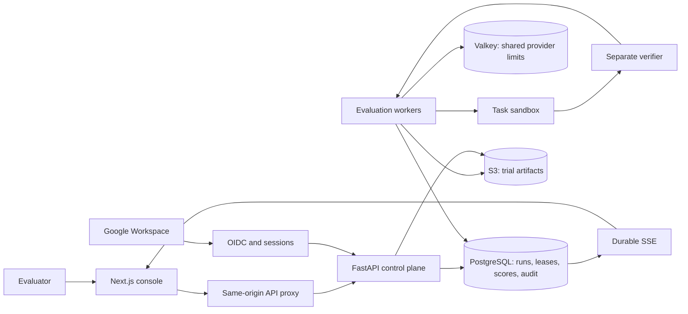
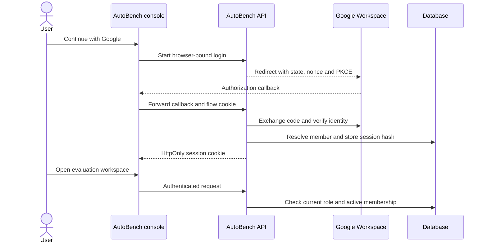

<div align="center">


# 🚀 AutoBench

### Evaluate LLM agents. Inspect the evidence. Measure reliability.

<p>
A full-stack evaluation platform for LLM agents, with isolated task execution,
state-based grading, live run monitoring, reproducible trial evidence,
and capability and reliability metrics side by side.
</p>

<p>
  
  
  
  
</p>

<p>
  
  
  
  
</p>

<p>
  <a href="https://github.com/KushagraSrivastava3028/AutoBench/actions/workflows/ci.yml"></a>
  
  
</p>

[Quick start](#-quick-start) · [Features](#-key-features) · [Architecture](#-system-architecture) · [Deployment](#-deployment) · [Remaining work](AUTOBENCH_REMAINING_WORK.md)

</div>

---

## 📌 Overview

**AutoBench** runs a versioned task repeatedly against an agent/model pair and grades the resulting workspace. A successful explanation alone does not count as a successful task: the verifier checks the final state.

The console connects run planning, worker execution, scoring, cost tracking and debugging. Each trial exposes its verdict, trajectory, filesystem changes, provenance and replay commands.

> **Project status:** Core workflows and the UI are implemented. Google Workspace sign-in and an EC2 deployment package are included. Production deployment, sandbox hardening, project isolation and the remaining PRD release gates are still in progress. See the [remaining-work checklist](AUTOBENCH_REMAINING_WORK.md).

### Core workflow

```text
Choose a task suite
        ↓
Select agent, model, attempts and budget
        ↓
Launch an evaluation
        ↓
Workers execute and verify each trial
        ↓
Inspect scores, reliability, cost and evidence
        ↓
Compare runs and replay failures
```

---

## ✨ Key Features

### 🎨 Evaluation console

- Responsive bento overview with light/dark themes.
- Real active runs, queue counts, spend, comparable trends and infrastructure alerts.
- Search, keyboard navigation, run filters and trial inspection side sheets.
- Run comparisons, leaderboards, task/suite libraries and operations views.

### 🧪 Versioned tasks and state-based grading

- Content-addressed task versions and suites pinned to published versions.
- Task upload, static validation, draft saving, Docker calibration and publication.
- A separate verifier grades the final workspace using task-owned tests.
- Infrastructure failures are tracked separately from agent failures.

### 📊 Capability and reliability

| Metric | What it tells you |
|---|---|
| **pass@1** | Success probability for an individual attempt |
| **pass@k** | Capability: at least one success across k attempts |
| **pass^k** | Reliability: all k attempts succeed |
| **Reliability gap** | Difference between pass@k and pass^k |
| **Cost and latency** | Recorded trial spend, tokens and execution time |

Metrics include confidence intervals. Suite pass@1 accounts for task clustering when repeated attempts are present; comparisons require scored, matching task versions. Invalid harness runs are excluded from leaderboards.

### 🔎 Trial evidence and replay

- Paged, virtualized trajectories and filesystem diffs.
- Verifier item results, error classification and run provenance.
- Exact decimal seed fields to preserve 64-bit seeds in the browser.
- Replay commands tied to the actual trial seed and task content hash.

### ⚡ Worker orchestration

- PostgreSQL-backed trial leasing and recovery of expired leases.
- Separate concurrency budgets for containers, Docker operations and verifiers.
- Durable server-sent events with reconnect/resume support.
- Worker heartbeats, cancellation, failed-trial retry and per-run budget caps.

### 🔐 Workspace access

- Google Workspace OAuth 2.0 / OIDC sign-in with domain allowlisting.
- Revocable browser sessions; only session-token hashes are stored in the database.
- Viewer, runner, author and administrator roles.
- Member administration, scoped API keys, key revocation and audit history.
- One shared workspace per deployment today; project-scoped isolation remains on the roadmap.

### 🤖 Agent and model integrations

The codebase includes an internal ReAct agent, oracle/null agents, external-agent adapters, and provider integrations for OpenAI, Anthropic, Google and OpenAI-compatible endpoints. A deterministic mock provider supports offline development without paid model calls. Verify each external adapter/provider in your target environment before use.

---

## 🏗️ System Architecture



Local development can use SQLite, local artifacts and a local process executor. The EC2 package targets PostgreSQL 17, Valkey 8, S3 and Docker with `runsc`. **The local executor provides no isolation and is refused in production mode.**

---

## 🛡️ Role-Based Access

Backend permissions are enforced independently of UI controls.

| Action | Viewer | Runner | Author | Admin |
|---|:---:|:---:|:---:|:---:|
| Read runs, trials, tasks and leaderboards | ✅ | ✅ | ✅ | ✅ |
| Launch, cancel and retry evaluations | — | ✅ | ✅ | ✅ |
| Validate/publish tasks and create suites | — | — | ✅ | ✅ |
| Manage members and API keys | — | — | — | ✅ |
| Change workspace budget and inspect audit history | — | — | — | ✅ |

New Google Workspace members receive viewer access unless explicitly allowlisted as initial administrators. Existing member roles are managed in **Settings → Members**. Disabling a member revokes their sessions.

---

## 📂 Project Structure

```text
AutoBench/
├── frontend/                  # Next.js / React console and browser tests
├── src/autobench/
│   ├── api/                   # REST, Google OIDC, console and SSE
│   ├── agents/                # Agent implementations and adapters
│   ├── artifacts/             # S3/local artifacts and trajectories
│   ├── cli/                   # Run, validate, compare, replay and benchmark CLI
│   ├── core/                  # Configuration, security and telemetry
│   ├── db/                    # SQLAlchemy models and Alembic migrations
│   ├── executor/              # Docker and development-local execution
│   ├── models/                # Model providers, pricing and rate limits
│   ├── scoring/               # Verifier and statistical estimators
│   ├── taskspec/              # Task schema, hashing, validation and import
│   └── worker/                # Planning, leasing, execution and recovery
├── tasks/_reference/          # Current four-task reference corpus
├── tests/                     # Unit, integration, end-to-end and hostile fixtures
├── images/                    # Verifier and proxy image sources
├── ops/ec2/                   # CloudFormation, TLS and backup configuration
├── scripts/                   # Local startup and deployment validation
├── docs/                      # Architecture, authoring, security and operations
├── design-reference/          # Original UI handoff reference
├── bench/                     # Recorded harness benchmark evidence
├── docker-compose.ec2.yml     # Standalone EC2 deployment configuration
└── AUTOBENCH_REMAINING_WORK.md # Prioritized implementation/release checklist
```

---

## ⚙️ Technology Stack

| Layer | Technologies |
|---|---|
| Frontend | Next.js 16, React 19.2, TypeScript, Tailwind CSS |
| Data/UI | TanStack Query, TanStack Virtual, Recharts, generated OpenAPI types |
| Backend | Python 3.12+, FastAPI, Pydantic, SQLAlchemy, Alembic |
| Production storage target | PostgreSQL 17, Valkey 8, AWS S3 |
| Local storage | SQLite and local artifact files |
| Authentication | Google Workspace OIDC, opaque browser sessions, scoped API keys |
| Execution | Docker; optional local executor for development |
| Deployment target | AWS EC2, Linux, Docker Compose, Caddy, Python 3.13 application image |
| Quality | pytest, Ruff, mypy, Playwright, GitHub Actions |
| Observability | OpenTelemetry, Prometheus and Grafana configuration |

---

## 🚀 Quick Start

### 1. Clone and install

Prerequisites: Git, [uv](https://docs.astral.sh/uv/), Python 3.12 or newer, and Node.js 22 or newer. Python 3.13 is used by the application Docker image.

```bash
git clone https://github.com/KushagraSrivastava3028/AutoBench.git
cd AutoBench
uv venv --python 3.13 .venv
uv pip install -e ".[dev]"
```

Copy `.env.example` to `.env`, and `frontend/.env.example` to `frontend/.env.local`. Defaults support offline local development. Install optional provider/export dependencies when needed:

```bash
uv pip install -e ".[dev,providers,export]"
```

### 2. Seed and run an offline evaluation

```bash
uv run --no-sync autobench seed
uv run --no-sync autobench run --suite core-reference --agent oracle --model mock/mock-1 --k 3
```

The oracle uses the reference task solutions; the mock provider needs no model API key. The reference corpus currently contains **four tasks**, so this is a development self-check, not the PRD's 50-task production benchmark.

### 3. Start the API and worker

In one terminal:

```bash
uv run --no-sync autobench serve --host 127.0.0.1
```

In a second terminal:

```bash
uv run --no-sync autobench worker
```

### 4. Start the console

In a third terminal:

```bash
cd frontend
npm ci
npm run dev
```

| Service | Local address |
|---|---|
| Console | http://localhost:3000 |
| API documentation | http://localhost:8000/docs |

For a production frontend build, use `npm run build` followed by `npm start`. On Windows, after installing dependencies and seeding, `./scripts/start-local.ps1 -Build` starts the API, worker and built UI in the background. It refuses to start over occupied application ports.

Authentication is disabled by default locally. Enable it in **both** the backend and frontend when protecting a deployment. Use Docker before executing untrusted tasks.

---

## 🔌 API and CLI

The API documentation at `/docs` is the authoritative endpoint reference. Browser calls go through the console's same-origin `/api` proxy; direct backend routes use `/v1`.

| Endpoint | Purpose |
|---|---|
| `POST /v1/runs` | Plan and queue an evaluation |
| `GET /v1/runs/{id}` | Run details and aggregate metrics |
| `GET /v1/runs/{id}/matrix` | Per-task attempt matrix |
| `GET /v1/runs/{id}/events` | Live run updates via SSE |
| `POST /v1/runs/{id}/cancel` | Cancel a run |
| `POST /v1/runs/{id}/retry-failed` | Retry failed trials |
| `GET /v1/trials/{id}/trajectory` | Paged trial trajectory |
| `GET /v1/trials/{id}/diff` | Filesystem changes |
| `GET /v1/trials/{id}/replay` | Reproduction commands |
| `GET /v1/auth/members` | Workspace membership administration |
| `GET /v1/console/overview` | Real dashboard data |

```bash
uv run --no-sync autobench validate tasks/ --deep
uv run --no-sync autobench run --suite core-reference --agent oracle --k 5
uv run --no-sync autobench bench-harness --concurrency 1,2,4,8
uv run --no-sync autobench gate --baseline BASELINE_ID --candidate CANDIDATE_ID
uv run --no-sync autobench replay --trial TRIAL_ID
uv run --no-sync autobench keys --create "CI integration" --scopes read,run
```

Machine clients authenticate with `X-API-Key` or `Authorization: Bearer`. Store generated keys securely; never commit them.

---

## 🔐 Google Workspace Sign-In



Configure the OAuth client, allowed Workspace domains, explicit bootstrap administrators and HTTPS public origin. The exact browser callback is:

```text
https://YOUR_HOST/api/auth/google/callback
```

Google signature, issuer, audience, expiry, nonce, verified email and signed Workspace-domain claims are checked. See the [deployment guide](docs/ec2-google-deployment.md) for configuration and live acceptance steps.

---

## 🚢 Deployment

The chosen target is **AWS EC2 + Linux + Docker**, with **Google Workspace SSO**.

| Included file | Purpose |
|---|---|
| `docker-compose.ec2.yml` | Standalone API, worker, UI, PostgreSQL 17, Valkey 8 and Caddy stack |
| `ops/ec2/stack.json` | EC2/IAM/S3/network/snapshot foundation |
| `ops/ec2/production.env.example` | Deployment environment template |
| `ops/ec2/Caddyfile` | HTTPS reverse proxy configuration |
| `ops/ec2/backup.sh` | Database and task-source backup script |
| `scripts/validate_ec2_config.py` | Rendered configuration checks |

Follow [EC2 and Google deployment](docs/ec2-google-deployment.md). Use the standalone EC2 file rather than merging it with development Compose. Real production credentials, live OAuth/TLS checks, Linux Docker validation, recovery testing and PRD release acceptance remain required.

The development Compose file remains available for a local infrastructure stack. Deployment configuration is not evidence that production has been provisioned.

---

## 🧰 Testing and Quality

```bash
uv run --no-sync pytest tests -q
uv run --no-sync ruff check src tests
uv run --no-sync ruff format --check src tests
uv run --no-sync mypy src
```

With the seeded API, worker and frontend running:

```bash
cd frontend
npm run typecheck
npm run build
npm run test:browser
```

Browser tests use installed Chrome locally and Chromium in CI. The suite covers desktop/mobile layouts, keyboard dialogs, origin protection and a real offline evaluation. Google identity tests include signed-token verification and browser/session permission cases. Inspect CI results and the [remaining-work checklist](AUTOBENCH_REMAINING_WORK.md) for the current validation status.

Historical harness measurements are retained in [`bench/`](bench/). Those measurements use the small local reference corpus and do not establish production throughput or completion of the PRD benchmark target.

---

## 🎯 Remaining Work

- Finish final combined tests, migration checks and browser acceptance.
- Deploy and validate the EC2 environment and live Google Workspace integration.
- Complete sandbox isolation and image supply-chain enforcement.
- Add project-level data isolation, scoped memberships and remaining budget/audit requirements.
- Expand the reference corpus from four tasks to fifty and complete capacity/cost acceptance.
- Exercise crash recovery, backup restoration, operational runbooks and the 14-day staging soak.

The full prioritized checklist, including completion evidence, is in **[AUTOBENCH_REMAINING_WORK.md](AUTOBENCH_REMAINING_WORK.md)**.

---

## 📚 Documentation

| Guide | Contents |
|---|---|
| [Architecture](docs/architecture.md) | Control plane, execution and storage |
| [Task authoring](docs/task-authoring.md) | Task format and validation |
| [Scoring](docs/scoring.md) | Grading and statistical interpretation |
| [Security](docs/security.md) | Security model and boundaries |
| [Operations](docs/operations.md) | Operational guidance |
| [UI handoff implementation](docs/ui-handoff-implementation.md) | Implemented UI and current limitations |
| [EC2 and Google deployment](docs/ec2-google-deployment.md) | Hosting, identity, backups and release acceptance |
| [Product requirements](AUTOBENCH_PRD%20(1).md) | Product and engineering requirements |

Some design documents describe the target architecture. Use the implementation notes and remaining-work checklist to distinguish shipped behavior from planned requirements.

---

## 🤝 Contributing

1. Fork the repository and create a focused feature branch.
2. Check the PRD and remaining-work checklist before changing behavior.
3. Add meaningful coverage for changed execution, security or scoring contracts.
4. Run the applicable checks and open a pull request with validation results.

```bash
git checkout -b feature/your-change
git add .
git commit -m "Describe your change"
git push -u origin feature/your-change
```

## 📜 License and Maintainer

Project metadata declares **Apache-2.0** in [`pyproject.toml`](pyproject.toml).

Maintained by [Kushagra Srivastava](https://github.com/KushagraSrivastava3028).

---

<div align="center">

### Measure capability. Understand reliability. Inspect the evidence.

Built with Python, FastAPI, Next.js and React.


</div>
